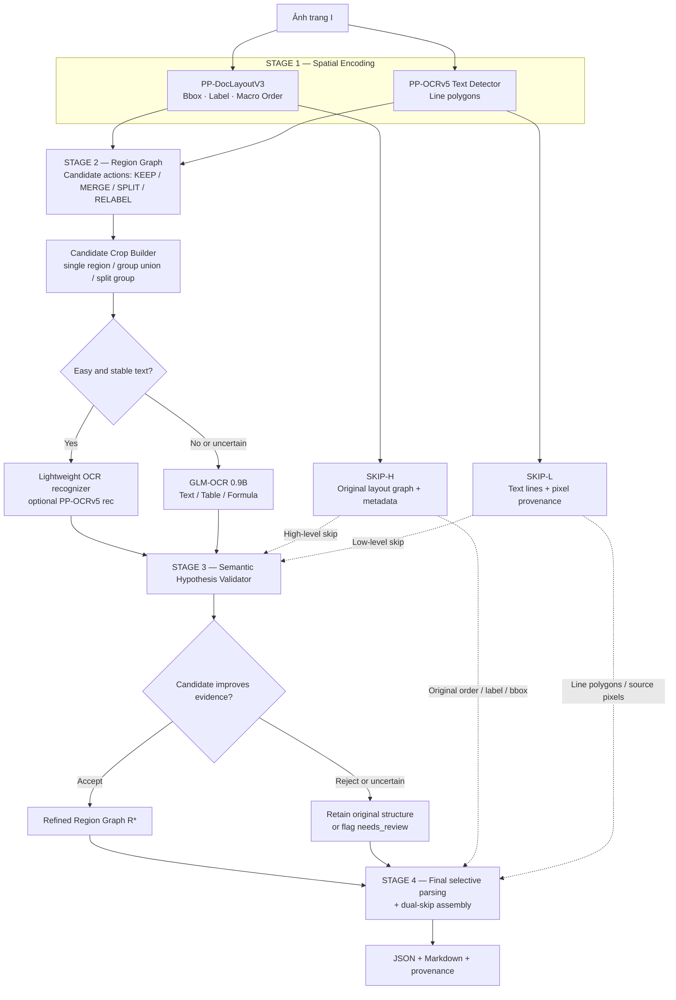
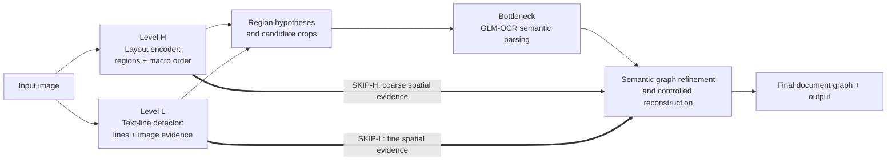
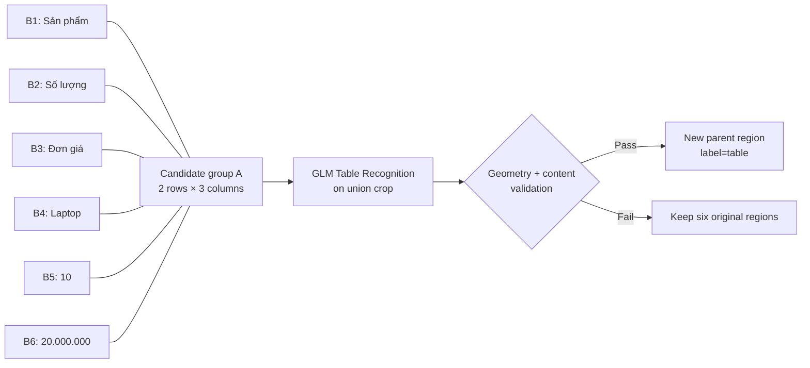
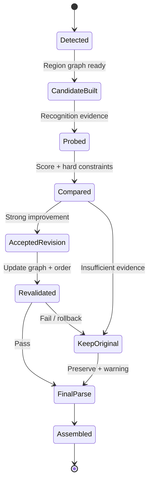
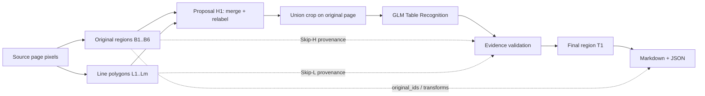
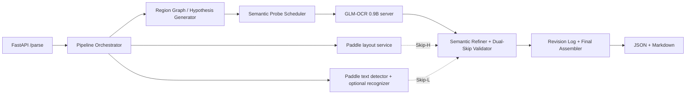

# Semantic-Guided Dual-Skip Document Parsing
## PP-DocLayoutV3 × PP-OCRv5 × GLM-OCR — U-Net-inspired Spatial Evidence + Semantic Feedback

> **Phiên bản:** 4.0 — 24/10/2026  
> **Trạng thái:** tài liệu thiết kế nghiên cứu / zero-training PoC; **chưa có triển khai hay kết quả benchmark**.  
> **Kế thừa:** `Paddle_GLM_OCR_Dual_Skip_Architecture_v3.md`.  
> **Thay đổi quan trọng nhất:** GLM-OCR **không chỉ nhận dạng nội dung**; nội dung được nhận dạng từ vùng đơn lẻ **và vùng hợp ứng viên** trở thành bằng chứng ngữ nghĩa để **xác minh lại nhãn, quyết định KEEP / MERGE / SPLIT / RELABEL và kiểm tra reading order** của các bbox do PP-DocLayoutV3 đề xuất.  
> **Ràng buộc:** tận dụng checkpoint có sẵn, không huấn luyện encoder/adapter, không thay đổi trọng số GLM-OCR.  
> **Nguyên tắc đặt tên:** *U-Net-inspired / dual skip ở tầng dữ liệu*, **không phải** neural U-Net với các feature map được nối giữa encoder/decoder.

---

## 0. Executive Summary — điều muốn chứng minh

### 0.1. Vấn đề thực sự

Một pipeline OCR hai giai đoạn truyền thống thường thực hiện:

```text
Trang ảnh → PP-DocLayoutV3 → BBox + nhãn + reading order
          → Crop → GLM-OCR → Ghép nội dung → Markdown / JSON
```

Nếu layout detector phát hiện **sai nhãn** (`text` thay vì `table`), **tách sai** một bảng thành nhiều hộp, **gộp sai** hai đoạn văn hoặc **bỏ sót** chú thích, GLM-OCR chỉ được xem những crop đã định sẵn. Một skip connection đơn thuần chuyển tiếp metadata sẽ **bảo toàn luôn sai sót** đó.

### 0.2. Giả thuyết nghiên cứu

> Nếu biết **vùng hình học** và **thứ tự đọc dự kiến**, đồng thời trích xuất được **nội dung** bằng GLM-OCR, liệu chúng ta có thể dùng sự nhất quán giữa **ngữ nghĩa ↔ hình học ↔ reading order** để *kiểm chứng và sửa lại nhãn, ranh giới, quan hệ gộp/tách của các vùng* mà không huấn luyện model mới?

Đề xuất kiểm chứng giả thuyết này bằng **Semantic-Guided Dual-Skip**:

- **Nhánh H — High-level spatial skip:** giữ **bbox/polygon/nhãn/reading order gốc** của PP-DocLayoutV3 và các quan hệ bố cục trên trang.
- **Nhánh L — Low-level spatial skip:** giữ **ảnh gốc + các polygon dòng chữ** từ text detector PP-OCRv5; tùy cấu hình thêm text recognition nhẹ cho vùng đơn giản.
- **Semantic bottleneck:** dùng **GLM-OCR 0.9B** đọc các vùng phức tạp/vùng nghi vấn và các **crop hợp giả thuyết**, từ đó cung cấp bằng chứng text/table/formula.
- **Semantic Layout Refiner:** so sánh *cấu trúc gốc* với *các cấu trúc thay thế*, chỉ cập nhật sau khi qua kiểm tra độc lập từ H và L.
- **Skip-Assembly:** dùng cả hai nhánh H/L cùng graph đã chấp nhận để truy vết nội dung tới tọa độ trang gốc.

**Mục tiêu không phải GLM tự vẽ lại mọi bbox.** GLM trả nội dung có cấu trúc; bộ điều phối dùng content evidence đó cùng dữ liệu hình học để quyết định sửa vùng. Mọi sửa đổi có `parent_ids`, `decision_reason`, `evidence` và khả năng rollback.

### 0.3. Phạm vi và điều KHÔNG tuyên bố

1. GLM-OCR **không được mặc định là layout classifier hoặc bbox regression model**. Các prompt được hỗ trợ chủ yếu phục vụ nhận dạng văn bản, bảng và công thức.
2. Việc `Table Recognition:` sinh HTML hợp lệ **không chứng minh** ảnh là bảng. Phải đối chiếu số dòng, phân bố ô và khả năng giữ lại nội dung.
3. Hai skip ở đây là **đường truyền bằng chứng**, không phải skip connections kết nối tensor đa tầng bên trong backbone. Muốn có neural U-Net thực thụ có thể cần adapter/huấn luyện.
4. Không có cơ chế nào đảm bảo 100% chính xác. Hệ thống phải **biết từ chối sửa** và trả `needs_review`.
5. Chất lượng và chi phí của vòng semantic refinement là giả thuyết cần **ablation trên ground truth**.

---

## 1. High-level architecture

### 1.1. Bốn giai đoạn logic, có vòng phản hồi ngữ nghĩa hữu hạn

| Giai đoạn | Nhiệm vụ | Công cụ | Kết quả |
|---|---|---|---|
| **1. Spatial encoding** | Nhận diện region-level layout + line-level evidence | PP-DocLayoutV3, PP-OCRv5 det | `R0` (vùng gốc), `T` (dòng chữ), `O0` (reading order) |
| **2. Region hypotheses** | Xây Region Graph và đề xuất `KEEP / MERGE / SPLIT / RELABEL` | Heuristics + graph rules + crop builder | Các giả thuyết `H0, H1, ...` kèm bằng chứng hình học |
| **3. Semantic bottleneck & feedback** | OCR nhẹ đối với text rõ; GLM đối với vùng phức tạp/nghi vấn; dùng kết quả để kiểm tra giả thuyết | PP-OCR recognizer **tùy chọn**, GLM-OCR, validators | `Y`, điểm so sánh, graph bố cục cuối `R*` |
| **4. Dual-skip reconstruction** | Parse lại **chỉ vùng bị thay đổi nếu cần**, ghép và xuất nội dung, giữ provenance | Skip-H + Skip-L + assembler | JSON/Markdown + audit trail + warnings |

**Không chạy lại toàn trang mặc định.** Số lần refinement giới hạn; kết quả OCR đã hợp lệ được tái sử dụng.

### 1.2. Mermaid — kiến trúc cấp cao



### 1.3. Mermaid — diễn giải U-Net ở mức dữ liệu



**Tương đồng với U-Net:** encoder giữ chi tiết thô/tinh ở hai cấp; bottleneck xử lý thông tin cấp cao; decoder/refiner sử dụng lại các tín hiệu không gian bị mất nếu chỉ dùng output semantic. **Khác U-Net chuẩn:** thông tin truyền tắt là **object/graph/image records**, không phải latent features theo từng tầng. Cần mô tả đúng trong báo cáo khoa học.

---

## 2. Ký hiệu toán học và mục tiêu

### 2.1. Dự đoán ban đầu từ hai nguồn

Cho ảnh trang chuẩn hóa $I\in\mathbb{R}^{H\times W\times3}$:

$$
\mathcal{R}_0=f_{\mathrm{layout}}(I)
=\{r_i=(id_i,B_i,M_i,C_i,O_i,p_i)\}_{i=1}^{N},
$$

$$
\mathcal{T}=f_{\mathrm{textdet}}(I)
=\{t_j=(poly_j,q_j)\}_{j=1}^{m}.
$$

- $B_i$: hộp chữ nhật ở **tọa độ ảnh gốc**.
- $M_i$: polygon hoặc mask **nếu backend thực tế cung cấp**; không giả định wrapper nào cũng trả về.
- $C_i$: nhãn từ Paddle, **hypothesis chứ không phải ground truth**.
- $O_i$: thứ tự đọc ban đầu, cần chú ý một số API biểu diễn bằng **thứ tự danh sách**, không phải field `order` riêng.
- $p_i,q_j$: detection scores khi khả dụng; **không phải calibrated probabilities**.

### 2.2. Region Graph

Xây đồ thị ứng viên $G_0=(V,E)$:

$$
V=\mathcal{R}_0\cup\mathcal{R}_{\mathrm{residual}},
\qquad e_{ij}=(d_{ij},a_{ij},o_{ij},g_{ij}).
$$

- $d_{ij}$: khoảng cách, gap theo trục và cùng cột/khác cột.
- $a_{ij}$: mức căn lề, tính thẳng hàng, độ đều spacing.
- $o_{ij}$: quan hệ reading order hiện tại và constraints.
- $g_{ij}$: tính liên thông của hình học/dòng chữ; **chưa phải** semantic similarity đã huấn luyện.

Một tập $A$ gồm **các vùng kề nhau hợp lệ trên graph** sẽ tạo các giả thuyết:

$$
H_0(A)=\mathrm{KEEP}(A),\quad
H_1(A)=\mathrm{MERGE}(A),\quad
H_2(A)=\mathrm{SPLIT}(A),\quad
H_3(A)=\mathrm{RELABEL}(A,C').
$$

Chỉ sinh giả thuyết từ **candidates có căn cứ**; tránh tổ hợp mọi subset vì số trường hợp tăng bùng nổ.

### 2.3. GLM là nguồn bằng chứng ngữ nghĩa, không phải oracle

Với ảnh crop $I_H$ của một giả thuyết $H$ và prompt $P_c$:

$$
Y_{H,c}=f_{\mathrm{GLM}}(I_H,P_c),
\quad c\in\{\text{text, table, formula}\}.
$$

Điều phối viên nhận `Y` và xây các **features có thể kiểm tra** (ví dụ: số ô HTML, cấu trúc hàng/cột, CER so với OCR độc lập, các line ID được bao phủ). Không lấy một logit “GLM confidence” tùy tiện nếu SDK không hỗ trợ.

### 2.4. Chọn giả thuyết, có penalty và abstention

$$
\operatorname{Score}(H)=
 w_gS_g(H)+w_rS_r(H)+w_cS_c(H)+w_sS_s(H)
 -w_lP_{loss}(H)-w_kP_{complexity}(H).
$$

| Thành phần | Ý nghĩa | Dữ liệu để kiểm chứng |
|---|---|---|
| $S_g$ | Hình học, khoảng cách/căn lề, phù hợp cùng vùng | Skip-H + Skip-L |
| $S_r$ | Tính nhất quán macro reading order, không phá cột/heading | Skip-H + Region Graph |
| $S_c$ | Nội dung của các vùng có được bảo toàn và nhất quán không | GLM + OCR độc lập (nếu bật) + line coverage |
| $S_s$ | Cấu trúc vùng sau sửa (hàng/cột, công thức, đoạn) có hợp lý không | GLM parsed HTML/LaTeX + geometric checks |
| $P_{loss}$ | Hình học hoặc chữ bị mất, trùng lặp, nhiễm từ vùng khác | Pixel/line evidence và text consistency |
| $P_{complexity}$ | Sửa quá nhiều vùng, đổi nhãn vô căn cứ | Change log / edit count |

**Quy tắc bảo thủ:** chỉ chấp nhận $H^*\ne H_0$ nếu thỏa các hard constraints, đồng thời

$$
\operatorname{Score}(H^*)-\operatorname{Score}(H_0)\ge\Delta
\quad\text{và}\quad\operatorname{Score}(H^*)\ge\tau_{accept}.
$$

Các $w,\Delta,\tau$ là **siêu tham số thiết kế**, phải chuẩn hóa feature và hiệu chỉnh trên validation set; không đưa ra độ tin cậy 99% khi chưa hiệu chuẩn. Nếu không đủ bằng chứng: `KEEP + needs_review`, không cưỡng ép relabel.

---

## 3. Chi tiết thành phần và trách nhiệm

### 3.1. PP-DocLayoutV3 — macro spatial encoder

- Sinh *region proposals*: text, title, table, formula, list, caption, figure/chart... (theo label taxonomy khả dụng).
- Cung cấp bbox/multi-point polygon và thứ tự đọc ở **cấp vùng**.
- Giữ `layout_label_initial` và `order_initial` **bất biến** trong log.
- **Không** coi dự đoán là ground truth. Nhãn cuối có thể khác sau semantic validation.

### 3.2. PP-OCRv5 text detector — low-level spatial encoder

- Sinh `textline_id`, `polygon`, `score` nếu có; giúp phát hiện dòng bị bỏ sót và ranh giới chi tiết.
- Mỗi line được gán `owner_region` (hoặc `unassigned/ambiguous`) có log.
- Không thể tự nhận diện bảng/công thức **chỉ bằng output detection**.
- Không được sử dụng detector để làm biến mất đường kẻ bảng, ký hiệu toán hay figure phi chữ.

### 3.3. OCR nhẹ cho văn bản thường — **tùy chọn nhưng khuyến nghị**

Với những vùng `text/title/caption/list` có nhãn và crop ổn định, dùng PP-OCR recognizer để trích xuất ký tự. Hai lợi ích:

1. **Tiết kiệm:** không cần gọi GLM cho mọi paragraph.
2. **Đối chiếu:** có transcript độc lập, giúp phát hiện GLM làm mất dòng hoặc diễn giải sai.

Tuy nhiên PP-OCR detection và recognition thường cùng pipeline; đây là **tín hiệu bổ sung**, không phải ground truth hoàn toàn độc lập. Với công thức phức tạp, bảng và vùng nghi vấn, chuyển sang GLM.

### 3.4. Region Graph Builder

- Tạo cạnh lân cận dựa vào cùng cột, overlap line bands, heading-body, caption-figure, reading-order constraints.
- Liên kết `textline_ids` với vùng.
- Sinh *candidate groups* theo hình học, không dựa vào mọi cặp bbox toàn trang.
- Đánh dấu `cross_column_risk`, `table_candidate`, `clipped_text`, `mixed_content`, `reading_order_ambiguous`.

### 3.5. Hypothesis Generator

Bốn hành động được thiết kế như các **đề xuất có provenance**, không chỉnh sửa trực tiếp region list:

| Hành động | Điều kiện kích hoạt để *đề xuất* | Biến đổi dự kiến | Rủi ro |
|---|---|---|---|
| `KEEP` | Default và khi bằng chứng yếu | Giữ nguyên $R_i$ | Có thể giữ nguyên lỗi |
| `MERGE` | Các vùng gần nhau, chung cấu trúc hàng/cột/đoạn, order tương thích | Tạo vùng cha từ nhiều child; label mới tùy chứng cứ | Gộp nhầm hai cột, mất caption |
| `SPLIT` | Một bbox chứa nhóm dòng/nhãn không tương thích và có đường ranh rõ | Tách theo cụm line/pixel; lưu parent | Chia cắt bảng/công thức |
| `RELABEL` | Nhãn layout ban đầu mâu thuẫn với semantic + spatial evidence | Đổi `final_label`, **không** ép đổi bbox | Prompt chuyển sai loại |

Với `MERGE + RELABEL`, hai thao tác diễn ra trong cùng giả thuyết nhưng phải log rõ: ví dụ `text × 6 → table × 1`.

### 3.6. Candidate Crop Builder

Với mỗi giả thuyết được phép thử, tạo **crop ảnh gốc tương ứng**, không ghép chuỗi OCR để giả tạo một vùng ảnh. Giữ hai bản khi có thể:

- `crop_raw`: hình chữ nhật đủ rộng, không mask phá nội dung.
- `crop_masked`: chỉ dùng khi mask tin cậy và **đã cập nhật** sau merge/expand/split.

`MERGE` tạo bounding envelope bao toàn nhóm, kèm exclusion mask có điều kiện; phải bảo vệ các dòng thuộc vùng khác. `SPLIT` sử dụng cụm line polygon/segmentation đáng tin hoặc flag review nếu ranh giới mơ hồ.

### 3.7. GLM-OCR — semantic evidence & final complex parser

| Lớp bài toán | Prompt gốc | Vai trò |
|---|---|---|
| Chữ/đoạn | `Text Recognition:` | Trích xuất transcript một vùng hoặc vùng hợp |
| Bảng | `Table Recognition:` | Trích xuất cấu trúc hàng/cột, HTML hay dạng được hỗ trợ |
| Công thức | `Formula Recognition:` | Sinh biểu diễn LaTeX để kiểm tra và phục dựng |

**Không giả định GLM tự xuất JSON với các nhãn `MERGE`, `SPLIT`, `RELABEL`.** Orchestrator tạo giả thuyết, gọi các task model có sẵn và kiểm tra output. Có thể thử prompt text và table cho **một candidate đáng nghi**, nhưng không thử mọi prompt cho toàn bộ trang.

`figure/chart`: nếu không có task hình chuyên dụng được xác minh, giữ crop và nhãn hình, không giả định ba prompt ở trên cho kết quả phân tích biểu đồ hoàn chỉnh.

### 3.8. Semantic Layout Refiner — thành phần nghiên cứu trung tâm

Trách nhiệm gồm: (1) chuyển output GLM thành features, (2) so sánh $H_0$ với $H_1...H_m$, (3) áp dụng constraints và chọn phương án tốt hơn **có biên an toàn**, (4) tạo `RegionRevision` kèm nguồn bằng chứng, (5) hỗ trợ rollback.

Tầng này **không phải** một model tham số học mới. Ban đầu có thể dùng rule-based scoring + validation set để điều chỉnh weights.

### 3.9. Dual-Skip Validator & Final Assembler

- **Skip-H:** bbox/polygon/order/label ban đầu + quan hệ nhóm/cột.
- **Skip-L:** line polygons + ảnh gốc + crop transforms + OCR transcript rẻ nếu có.
- Kiểm tra graph mới có làm mất vùng, lặp vùng hoặc vi phạm order hay không.
- Chỉ **reparse vùng đã thay đổi** khi nội dung trước đó không còn áp dụng cho geometry mới.
- Xuất tài liệu + lineage: có thể truy ra vì sao một vùng bị merge/relabel.

---

## 4. Kiến trúc region graph: đây là chỗ quyết định gộp/tách/đổi nhãn

### 4.1. Phân tầng node

- `LayoutRegionNode`: bbox cấp đoạn/bảng/hình từ PP-DocLayoutV3.
- `TextLineNode`: polygon dòng, có thể gán nhiều candidate owner nhưng chỉ một owner cuối hoặc `ambiguous`.
- `ProposalNode`: vùng thử nghiệm (`MERGE`, `SPLIT`, `RELABEL`) **chưa được chấp nhận**.
- `FinalRegionNode`: vùng đã được chấp nhận để xuất.

### 4.2. Mermaid — ví dụ graph của bảng không viền



**Ví dụ:** nếu PP-DocLayoutV3 trả sáu vùng `text` cho một bảng không viền, ứng viên `MERGE+RELABEL(table)` chỉ được chốt khi:

1. Các cột/hàng có căn chỉnh không gian nhất quán, không vượt cột tài liệu sai.
2. Crop gộp giữ đủ cả sáu nhóm dòng, không hút chữ của đoạn khác.
3. GLM trích xuất cấu trúc bảng có thể đối chiếu với phân bố dòng và transcript nguồn.
4. Không mất hoặc sinh thêm dữ liệu đáng kể; nếu có nghi vấn, `needs_review`.
5. Vị trí reading order mới thay thế một nhóm liền mạch mà không tạo chu trình.

Sau khi chấp nhận, `table.parent_ids=[B1,...,B6]`, `table.bbox` được tính từ vùng hợp, và các bbox con **không bị xóa khỏi provenance**.

### 4.3. Không được gộp dựa trên ngữ nghĩa đơn độc

Ví dụ `Total Revenue` và `Revenue Growth` có quan hệ ý nghĩa nhưng ở hai cột độc lập. Semantic similarity không được phép thắng hard constraints về reading order/cột khi không có pixel evidence.

Tương tự, đoạn văn trên hai cột đôi khi liên tục về ngữ nghĩa nhưng **không nên merge bbox qua cả hai cột**: có thể gắn cạnh logic *continued-by* mà giữ hai vùng không gian tách biệt.

### 4.4. SPLIT khó hơn MERGE

Tách một bbox đòi hỏi **đường ranh không gian mới**. Vì vậy:

- Chỉ split khi textline clusters hoặc các đường biên ảnh cho thấy sự tách rõ.
- `SPLIT(text + formula)` có thể tạo hai child bboxes từ line clusters và kiểm tra mỗi phần bằng prompt tương ứng.
- Nếu đối tượng phi chữ như hình/biểu đồ không thể định vị chính xác từ text detector, **không giả vờ có tọa độ chính xác**; giữ vùng cha và đánh dấu `mixed_content`.

### 4.5. Macro reading order được cập nhật sau merge/split

- `MERGE`: node cha nhận tập các node con; chỉ thay thế nhóm liên tiếp/đã kiểm chứng hợp lý trong thứ tự đồ thị.
- `SPLIT`: các node con được sắp theo order cục bộ có hỗ trợ pixel/line evidence; nối vào vị trí node cha.
- `RELABEL`: thông thường giữ order, nhưng review khi nhãn ảnh hưởng grouping.
- Graph cuối phải có DAG; không đơn thuần sort global `y` cho tài liệu đa cột.

---

## 5. Chi tiết hai đường truyền tắt (Dual Skip)

### 5.1. Skip-H: coarse/global spatial evidence

```text
Image I
  -> PP-DocLayoutV3
    -> original_region_id
    -> bbox_original / polygon_original
    -> layout_label_initial / score
    -> order_initial
    -> column / parent / neighbor relations
    -> image/page coordinate transform
                           └──────────────────────┐
                                                  ▼
                                 Semantic Layout Refiner
                                                  ▼
                                           Final Assembly
```

Skip-H đóng vai trò **neo vĩ mô**. Nó không được overwrite bởi `label_final`, `bbox_final`, `order_final`. Cần giữ các cặp original/final để so sánh.

### 5.2. Skip-L: fine/local spatial evidence

```text
Image I
  -> PP-OCRv5 text detector
    -> textline polygons / ownership
    -> uncovered line candidates
    -> crop_raw and crop_masked references
    -> optional lightweight OCR transcripts
    -> original source image / transform
                           └──────────────────────┐
                                                  ▼
                                 Semantic Layout Refiner
                                                  ▼
                                           Final Assembly
```

Skip-L dùng để kiểm tra **vùng mới có thật sự chứa chữ/đường nét cần thiết hay không**, đồng thời phát hiện mất/trùng nội dung. Nó không thể thay thế kiểm chứng tính đúng của nội dung phi chữ.

### 5.3. Vì sao phải dùng cả hai?

| Tình huống | Skip-H giúp gì? | Skip-L giúp gì? | GLM giúp gì? |
|---|---|---|---|
| Bảng không viền bị tách thành 6 `text` | Xác định 6 vùng và order vĩ mô | Kiểm tra các dòng thẳng hàng và coverage | Thử parse vùng hợp thành table |
| Paragraph bị crop mất dòng cuối | Lưu bbox cũ và cạnh hàng xóm | Phát hiện line cắt lẹm, nới crop an toàn | Nhận dạng crop mới |
| Tiêu đề bị gộp cùng đoạn | Ghi lại vị trí node/nhãn ban đầu | Tìm ranh giới dòng và khoảng cách | So sánh text group và caption structure |
| Công thức gán `text` | Cung cấp vị trí và nhãn ban đầu | Giữ ký hiệu nhỏ, superscript | Thử formula recognition, kiểm tra LaTeX |
| Hai cột bị merge sai | Cung cấp cột/order | Xác định line ownership | Transcript có thể phát hiện nối câu dị thường |

### 5.4. Bẫy polygon masking

Nếu bbox mở rộng nhưng polygon mask vẫn cũ, phần chữ vừa phát hiện sẽ bị tô trắng. Vì vậy `refined_mask` phải bao phủ **các line polygon được chấp nhận** và giữ đường kẻ/cấu trúc phi chữ cần thiết. Đối với bảng, công thức hoặc figure, **mặc định raw crop** khi mask có rủi ro xóa thông tin.

### 5.5. Cái gì không được dùng như proof?

- `layout_score > 0.9` không chứng minh nhãn đúng.
- HTML well-formed không chứng minh toàn bộ bảng khớp hình.
- LaTeX cân bằng ngoặc không chứng minh công thức đúng.
- GLM so sánh với chính output GLM khác không phải hai phép đo độc lập hoàn toàn.
- Hai skip có thể truyền cùng lỗi nếu hai detector cùng bỏ sót.

---

## 6. Chiến lược nhận dạng: OCR nhẹ + GLM theo mức khó

### 6.1. Routing policy

| Vùng | Dấu hiệu | Parser mặc định | Khi nào nâng cấp sang GLM |
|---|---|---|---|
| `title`, `text`, `list`, `caption` | label ổn, line coverage cao, không có candidate cấu trúc | PP-OCR recognizer (nếu bật), hoặc GLM Text | OCR rỗng/lệch, mixed-content, gộp/tách đáng nghi |
| `table`, `table_candidate` | đường cột/hàng, cấu trúc cell hoặc Paddle label table | GLM Table | Mặc định cần parsing bảng |
| `formula`, `formula_candidate` | ký hiệu toán, cấu trúc nhiều tầng hoặc Paddle label formula | GLM Formula | Mặc định cần parsing công thức |
| `unknown`, `residual` | text detector tìm dòng nằm ngoài layout | PP-OCR Text trước; GLM khi không rõ | Nhãn/structure không xác định |
| `figure`, `chart` | content phi chữ | Preserve crop + label; tùy optional specialized model | Không giả định GLM đủ ba prompt để hiểu chart |

Nếu tắt recognizer nhẹ, tất cả text có thể đi qua GLM như baseline A1. **Tách toggle** `enable_light_ocr` để ablation công bằng.

### 6.2. GLM nên gọi hai lần trong trường hợp nào?

Có thể có hai **lượt suy luận theo mục đích**, nhưng không phải hai lượt bắt buộc cho mọi vùng:

1. **Semantic probe:** GLM thử parse một `candidate group` hoặc vùng có nhãn mơ hồ, thu thập bằng chứng để quyết định graph.
2. **Final parse:** sau khi chốt `MERGE/SPLIT/RELABEL`, chạy GLM trên bbox mới **chỉ nếu** kết quả probe chưa đủ hoặc prompt/crop đã đổi. Nếu probe được chấp nhận cùng crop/prompt thì **tái sử dụng** output.

Đặt giới hạn `max_hypotheses_per_group`, `max_semantic_passes`, `max_glm_requests_per_page` để tránh chi phí tăng không kiểm soát.

### 6.3. Không sinh prompt tự do chưa được benchmark

Ưu tiên ba prompt được hỗ trợ bởi model card GLM-OCR:

```yaml
prompt_registry:
  text: "Text Recognition:"
  table: "Table Recognition:"
  formula: "Formula Recognition:"
```

`semantic_layout_refiner` **không phụ thuộc** GLM tuân theo một prompt yêu cầu trực tiếp `Please decide merge/split/relabel`. Nếu sau này nghiên cứu structured extraction, phải đánh giá riêng task prompts, output schema và độ ổn định.

---

## 7. Thuật toán quyết định — từ semantic evidence đến bbox chỉnh sửa

### 7.1. Quy trình trên một nhóm nghi vấn $A$

**Input:** $A=\{r_1,\ldots,r_n\}$; các line $T_A$; ảnh gốc $I$; region graph $G_0$.

1. Tạo $H_0$ (giữ nguyên) và một số $H_1,...,H_m$ được giới hạn, ví dụ `MERGE+RELABEL(table)` hoặc `SPLIT(text, formula)`.
2. Với mỗi $H$, tạo crop **từ ảnh gốc**, giữ map về source IDs.
3. Chạy recognizer tương ứng; chỉ thử GLM alternative prompts khi thực sự cần.
4. Chuẩn hóa transcript, parse HTML/LaTeX (nếu áp dụng); trích các geometry-consistency features.
5. Dùng Skip-H và Skip-L để loại phương án vi phạm hard constraints.
6. Tính score **theo cùng thang đo được hiệu chuẩn**; so với $H_0$.
7. Nếu hơn đủ margin và không mất thông tin: chấp nhận; nếu không: giữ nguyên + cảnh báo.
8. Cập nhật region graph và macro reading order, ghi đầy đủ `RegionRevision`.
9. Kiểm tra lại sau sửa; nếu không hợp lệ thì rollback.

### 7.2. Hard constraints cho MERGE

- Không phá trật tự hai cột, không gộp vùng quá xa mà thiếu quan hệ hình học.
- Không gộp `figure + caption` thành text đơn thuần nếu figure cần giữ riêng.
- Child regions không được xuất hai lần (một lần ở parent, một lần độc lập) trừ khi output model cần parent-child structure.
- Output phải giữ tất cả text lines đã được chấp nhận từ nguồn, hoặc cảnh báo rõ ràng.
- Không dựa hoàn toàn vào HTML well-formed.

### 7.3. Hard constraints cho SPLIT

- Có điểm chia với bằng chứng pixel/line; không “sáng tạo” bbox dựa trên nội dung văn bản thuần.
- Phân vùng không chồng lấn bất hợp lý, phủ đủ các line gốc, bảo toàn đường kẻ/bảng cần thiết.
- Nếu split gây missing tokens, reject.

### 7.4. Hard constraints cho RELABEL

- Không đổi nhãn chỉ vì prompt chuyên biệt đã sinh ra output có cú pháp hợp lệ.
- Sự phù hợp content phải đi kèm ít nhất một bằng chứng **không phải output cùng prompt** (geometry, independent OCR, GT-like rule hoặc ảnh gốc).
- Với bất định cao, lưu `candidate_labels`, gắn `needs_review`.

### 7.5. Bảng quyết định ví dụ

| Paddle proposal | Hypothesis | Nguồn chứng cứ bổ sung | Quyết định có thể |
|---|---|---|---|
| 6 × `text` | `MERGE+RELABEL(table)` | column alignment, line ownership, GLM HTML rows/cells, coverage | Accept nếu đồng nhất; không thì giữ 6 vùng |
| 1 × `text` có $\sum$, phân số | `RELABEL(formula)` | vùng hình chứa ký hiệu toán, GLM Formula, text OCR mismatch | Đổi nhãn nếu đủ chứng cứ |
| 1 × `text` bao cả heading và body | `SPLIT(title,text)` | line gap, font/geometry, reading order, transcript | Split khi biên rõ |
| 2 × text ở hai cột | `MERGE(text)` | semantic nối nghĩa nhưng geometry cross-column | Thường reject merge bbox; có thể lưu liên kết logical continuation |
| 1 vùng bị thiếu dòng cuối | `EXPAND_GEOMETRY` | uncovered text-line + safe crop | Nới bbox/mask, OCR lại |

> **Ghi chú:** `EXPAND_GEOMETRY` là thao tác sửa hình học bên trong `KEEP/REFINE` chứ không bắt buộc là nhãn semantic riêng. Trong file log có thể dùng `action=REFINE_BBOX` để dễ truy vết.

---

## 8. Mermaid — sequence của vòng semantic feedback

```mermaid
sequenceDiagram
    participant U as Client
    participant P as PP-DocLayoutV3
    participant T as PP-OCRv5 Detector
    participant G as Region Graph / Hypotheses
    participant O as Light OCR (optional)
    participant M as GLM-OCR
    participant V as Semantic Refiner + Dual-Skip Validator
    participant A as Final Assembler

    U->>P: Original page image
    U->>T: Same image
    P-->>G: Regions, original labels, reading order
    T-->>G: Text-line polygons
    G->>G: Assign line ownership, coverage, edges
    G->>G: Generate bounded alternatives H0..Hm
    opt Easy text candidates
      G->>O: Stable text crops
      O-->>V: OCR transcript evidence
    end
    loop Only ambiguous / complex candidates; bounded
      G->>M: Candidate crop + supported recognition prompt
      M-->>V: Text / HTML / LaTeX + candidate_id
    end
    G-->>V: Hypotheses + geometry constraints
    P-->>V: SKIP-H: original metadata
    T-->>V: SKIP-L: line/pixel evidence
    V->>V: Score H0 vs alternatives, validate hard constraints
    alt Strong evidence for change
      V->>G: Accept revision + update region/order graph
    else Ambiguous or worse
      V->>G: KEEP / needs_review
    end
    opt Accepted crop/prompt changed and result not reusable
      G->>M: Reparse affected final region only
      M-->>A: Final region content
    end
    G-->>A: Final region graph + complete lineage
    V-->>A: Accepted OCR results, checks, warnings
    A-->>U: JSON / Markdown + change log
```

### 8.1. Finite-state machine



`max_iterations=1` cho MVP nghĩa là một vòng hypothesis → evaluate → accept/reject; không dùng vòng lặp tự củng cố vô hạn. Có thể kiểm tra vòng hai trong thí nghiệm riêng sau khi chứng minh vòng một đáng chi phí.

---

## 9. Data contracts và provenance

### 9.1. Loại dữ liệu chính

| Record | Thuộc tính quan trọng |
|---|---|
| `LayoutRegion` | `id`, `bbox_original`, `polygon_original?`, `label_initial`, `order_initial`, `score`, `page_ref` |
| `TextLineEvidence` | `line_id`, `polygon`, `owner_candidates`, `transcript?`, `source_model` |
| `RegionHypothesis` | `hypothesis_id`, `action`, `source_region_ids`, `candidate_label`, `candidate_bbox`, `crop_ref`, `status` |
| `ParseEvidence` | `hypothesis_id`, `parser`, `prompt`, `content`, `attempt_id`, `validators`, `latency_ms?` |
| `RegionRevision` | `accepted_action`, `parent_ids`, `child_ids`, `before`, `after`, `scores`, `reasons`, `warnings` |
| `FinalRegion` | `final_id`, `bbox_final`, `label_final`, `order_final`, `content`, `source_ids`, `revision_id?` |

### 9.2. JSON output ví dụ — giá trị **giả lập**

```json
{
  "document_id": "demo_doc",
  "page_index": 0,
  "coordinate_space": {
    "image_width": 1654,
    "image_height": 2339,
    "orientation_transform": "identity"
  },
  "original_regions": [
    {"id": "B1", "bbox": [100, 250, 320, 294], "label": "text", "order": 2},
    {"id": "B2", "bbox": [340, 250, 560, 294], "label": "text", "order": 3},
    {"id": "B3", "bbox": [580, 250, 850, 294], "label": "text", "order": 4},
    {"id": "B4", "bbox": [100, 300, 320, 344], "label": "text", "order": 5},
    {"id": "B5", "bbox": [340, 300, 560, 344], "label": "text", "order": 6},
    {"id": "B6", "bbox": [580, 300, 850, 344], "label": "text", "order": 7}
  ],
  "revisions": [
    {
      "revision_id": "rev_01",
      "action": "MERGE_AND_RELABEL",
      "source_region_ids": ["B1", "B2", "B3", "B4", "B5", "B6"],
      "target_region_id": "T1",
      "old_labels": ["text", "text", "text", "text", "text", "text"],
      "new_label": "table",
      "geometry_evidence": ["two_aligned_rows", "three_column_clusters"],
      "semantic_evidence": ["table_candidate_parsed", "content_coverage_checked"],
      "validation": {
        "status": "accepted",
        "hard_constraints_passed": true,
        "score_delta": 0.18,
        "score_calibrated": false
      }
    }
  ],
  "final_regions": [
    {
      "id": "T1",
      "bbox_final": [96, 246, 854, 348],
      "label_initial_summary": "6 text regions",
      "label_final": "table",
      "order_final": 2,
      "source_region_ids": ["B1", "B2", "B3", "B4", "B5", "B6"],
      "prompt_used": "Table Recognition:",
      "content_format": "html",
      "content": "<table><tr><td>Sản phẩm</td><td>Số lượng</td><td>Đơn giá</td></tr><tr><td>Laptop</td><td>10</td><td>20.000.000</td></tr></table>",
      "status": "accepted"
    }
  ],
  "needs_review": [],
  "warnings": []
}
```

**Trong thực tế**, output cần thêm `polygon_final`, `textline_ids`, `page_ref`, `raw_crop_ref`, `mask_ref`, `transform` và các ID phiên bản. Các `score_delta` trong JSON chỉ là minh họa, **không phải độ tin cậy đã đo**.

### 9.3. Mermaid — lineage và bảo toàn vị trí



### 9.4. Invariants bắt buộc

1. `original_regions` không bị xóa hay sửa tại chỗ.
2. Every `final_region` có `source_region_ids` hoặc cờ `source=residual_detector`.
3. Merge có một parent output và không phát sinh duplicate child content.
4. Split giữ parent và liên kết đầy đủ tới child; các child có geometry truy vết về pixel.
5. Reading order sau sửa không có vòng và không bỏ vùng không chủ đích.
6. Mỗi request bất đồng bộ ghép bằng `hypothesis_id + region_id + attempt_id`, không theo thứ tự response.
7. Vùng bất định xuất cảnh báo thay vì gắn `accepted` vô căn cứ.

---

## 10. Pseudocode zero-training có vòng phản hồi GLM

> **Pseudocode kiến trúc** — các hàm bên dưới là interface **tự thiết kế**, không phải lời gọi có sẵn trong SDK `glmocr`.

```python
from dataclasses import dataclass
from typing import Literal

Action = Literal["KEEP", "MERGE", "SPLIT", "RELABEL", "REFINE_BBOX"]

@dataclass
class Hypothesis:
    hypothesis_id: str
    action: Action
    source_region_ids: list[str]
    candidate_label: str
    candidate_bbox: tuple[int, int, int, int]
    required_prompt: str | None


async def parse_page(page_image, layout_service, text_service,
                     light_ocr, glm_client, cfg):
    # 1. Dual spatial evidence, one coordinate space.
    layout = await layout_service.detect(page_image)
    text_lines = await text_service.detect_lines(page_image)
    original = freeze_original_regions(layout)

    # 2. Build graph; keep both spatial evidence streams.
    graph = build_region_graph(original, text_lines, page_image)
    residual = detect_residual_lines(graph, text_lines, cfg.coverage_threshold)
    graph = attach_residual_candidates(graph, residual)

    # 3. Generate bounded, grounded semantic hypotheses.
    groups = select_suspicious_groups(graph, cfg)
    hypotheses = generate_hypotheses(
        graph=graph,
        groups=groups,
        actions=("KEEP", "MERGE", "SPLIT", "RELABEL", "REFINE_BBOX"),
        max_per_group=cfg.max_hypotheses_per_group,
    )

    # 4. Cheap OCR for stable simple regions, if enabled.
    cheap_evidence = {}
    if cfg.enable_light_ocr:
        easy = select_stable_text_regions(graph)
        cheap_evidence = await light_ocr.recognize_many(
            make_safe_region_crops(page_image, easy),
            max_in_flight=cfg.max_in_flight,
        )

    # 5. GLM as semantic evidence for ambiguous / complex hypotheses.
    probe_requests = build_selective_probe_requests(
        page_image, hypotheses, graph, cheap_evidence, cfg
    )
    glm_evidence = await glm_client.recognize_many(
        probe_requests,
        max_in_flight=cfg.max_in_flight,
        request_budget=cfg.max_glm_requests_per_page,
    )

    # 6. Dual-skip semantic validation; KEEP is always a candidate.
    revisions = []
    for group in groups:
        choices = hypotheses_for_group(hypotheses, group)
        evaluation = evaluate_hypotheses(
            choices=choices,
            glm_evidence=glm_evidence,
            cheap_evidence=cheap_evidence,
            skip_high=original,
            skip_low=text_lines,
            original_image=page_image,
            cfg=cfg,
        )
        revision = accept_or_abstain(
            evaluation, min_gain=cfg.min_score_gain,
            min_absolute=cfg.min_absolute_score,
        )
        revisions.append(revision)

    # 7. Apply accepted revisions once, validate constraints, rollback if needed.
    refined_graph = apply_nonconflicting_revisions(graph, revisions)
    refined_graph = reconcile_order_as_dag(refined_graph)
    refined_graph = validate_or_rollback_graph(refined_graph, graph, revisions)

    # 8. Reuse prior OCR when crop/prompt match; otherwise parse only changed regions.
    final_recognitions = await resolve_final_contents(
        page_image=page_image,
        graph=refined_graph,
        cheap_results=cheap_evidence,
        glm_probe_results=glm_evidence,
        glm_client=glm_client,
        cfg=cfg,
    )

    # 9. Final dual-skip checks and traceable assembly.
    warnings = validate_document(
        final_graph=refined_graph,
        outputs=final_recognitions,
        original_regions=original,
        text_lines=text_lines,
        page_image=page_image,
    )
    return assemble_json_markdown(
        original_regions=original,
        final_graph=refined_graph,
        results=final_recognitions,
        revisions=revisions,
        warnings=warnings,
    )
```

### 10.1. Ví dụ validator bảng không viền

```python
def validate_table_hypothesis(candidate, table_output, skip_high,
                              skip_low, cheap_texts):
    """Conceptual checks, not a built-in GLM-OCR API."""
    rows = parse_html_table_if_possible(table_output)
    if not rows:
        return {"accepted": False, "flags": ["unparseable_table"]}

    flags = []
    if crosses_unrelated_columns(candidate, skip_high):
        flags.append("cross_column_merge")
    if loses_required_line_polygons(candidate, skip_low):
        flags.append("missing_lines")
    if not row_col_alignment_matches_image(rows, candidate, skip_low):
        flags.append("table_geometry_mismatch")
    if cheap_texts and not content_consistent(rows, cheap_texts):
        flags.append("content_disagreement")

    return {"accepted": not flags, "flags": flags}
```

**Quan trọng:** một check như `row_col_alignment_matches_image()` phải được implement cụ thể bằng geometric evidence và phép so khớp thực tế; ở đây chỉ là contract. Không thể suy đoán từ HTML hợp lệ rằng cell alignment đúng.

---

## 11. Service/API design và cấu trúc repository

### 11.1. Service topology — nhỏ gọn



Tách GLM inference server khỏi Paddle runtime **nếu** phiên bản CUDA/transformers/paddle gây xung đột. Với GPU nhỏ, giới hạn `max_in_flight` và tránh nạp đồng thời các model khi VRAM không đủ.

### 11.2. Repo đề xuất

```text
semantic-dual-skip-parser/
├── README.md
├── pyproject.toml
├── configs/
│   ├── default.yaml
│   ├── prompts.yaml
│   └── ablation.yaml
├── src/
│   ├── app.py                         # /parse endpoint
│   ├── adapters/
│   │   ├── layout_ppdocv3.py          # PP-DocLayoutV3 → normalized regions
│   │   ├── text_detector_ppocr.py     # line polygons
│   │   ├── light_ocr_ppocr.py         # optional text recognition
│   │   ├── glm_ocr_client.py          # GLM-OCR recognition requests
│   │   └── sdk_baseline.py            # GLM-OCR original SDK baseline
│   ├── spatial/
│   │   ├── coordinates.py             # pixel/orientation transforms
│   │   ├── region_graph.py
│   │   ├── line_assignment.py
│   │   ├── residual_regions.py
│   │   ├── crop_builder.py
│   │   └── reading_order.py
│   ├── semantic/
│   │   ├── candidate_generator.py     # KEEP/MERGE/SPLIT/RELABEL
│   │   ├── prompt_router.py
│   │   ├── probe_scheduler.py
│   │   ├── evidence_features.py
│   │   ├── hypothesis_scorer.py
│   │   └── semantic_layout_refiner.py # key research module
│   ├── skip/
│   │   ├── high_spatial_skip.py       # original layout/order
│   │   ├── low_spatial_skip.py        # text lines/pixels
│   │   ├── dual_skip_validator.py
│   │   └── revision_assembler.py
│   ├── schemas/
│   │   ├── region.py
│   │   ├── hypothesis.py
│   │   ├── evidence.py
│   │   └── output.py
│   └── evaluation/
│       ├── match_regions.py
│       ├── evaluate_detection.py
│       ├── evaluate_refinement.py
│       ├── evaluate_parsing.py
│       └── evaluate_latency.py
├── tests/
│   ├── test_borderless_table_merge.py
│   ├── test_wrong_label_formula.py
│   ├── test_heading_paragraph_split.py
│   ├── test_cross_column_merge_rejected.py
│   ├── test_refined_mask_keeps_residual_line.py
│   ├── test_order_dag_after_merge_split.py
│   ├── test_lineage_no_duplicate_contents.py
│   ├── test_uncertain_candidate_abstains.py
│   └── test_request_budget_is_bounded.py
└── experiments/
    ├── fixtures/
    ├── outputs/
    └── reports/
```

### 11.3. YAML khởi tạo (các ngưỡng cần tune)

```yaml
models:
  layout: "PP-DocLayoutV3"
  text_detector: "PP-OCRv5-det"
  light_ocr: "PP-OCRv5-rec"
  semantic_parser: "zai-org/GLM-OCR"

routing:
  enable_light_ocr: true
  complex_region_labels: ["table", "formula", "figure", "chart"]
  semantic_probe_on_ambiguous: true

hypotheses:
  enabled_actions: ["KEEP", "MERGE", "SPLIT", "RELABEL", "REFINE_BBOX"]
  max_hypotheses_per_group: 3
  max_candidate_group_size: 8
  max_iterations: 1
  coverage_threshold: 0.60
  allow_cross_column_merge: false

validation:
  min_score_gain: 0.10
  min_absolute_score: 0.60
  reject_on_missing_lines: true
  require_spatial_evidence_for_relabel: true
  enable_abstention: true

inference:
  max_in_flight: 4
  max_glm_requests_per_page: 30
  max_region_attempts: 2
  temperature: 0.0
  reuse_semantic_probe: true

output:
  keep_original_regions: true
  keep_source_lineage: true
  serialize_warnings: true
  emit_markdown: true
  emit_json: true
```

**Lưu ý:** các tên config/threshold là thiết kế độc lập của dự án, không có nghĩa GLM-OCR SDK có sẵn các option đó; cấu hình `temperature=0.0` phải kiểm tra server hỗ trợ. Hạn mức 30 request/trang chỉ là giá trị khởi tạo thử nghiệm, không phải lựa chọn tối ưu.

---

## 12. Experiment Design — phải đo *nhãn bbox* và *merge/split*, không chỉ CER

### 12.1. Bộ kiểm tra cần có ground truth

Tập đánh giá nên có ít nhất các nhóm:

1. Bảng không viền bị detector nhận thành nhiều text blocks.
2. Tài liệu nhiều cột, heading và caption chen giữa.
3. Công thức nhiều tầng, superscript/subscript sát mép bbox.
4. Đoạn văn bị tách/gộp sai, text sát biên.
5. Chữ nhỏ, footnote, watermark, figure chứa chữ.
6. Trang đơn giản để đo **over-correction** (pipeline mới sửa sai một bố cục vốn đã đúng).

Annotation tối thiểu: `GT regions + labels`, `GT reading order`, `GT merge/split groups`, `GT text/table/formula` ở nơi đo parsing.

### 12.2. Ablation tách từng đóng góp

| Cấu hình | Layout | Line det. | OCR nhẹ | GLM | Semantic refiner | Skip-H / Skip-L validation | Mục tiêu |
|---|---|---|---|---|---|---|---|
| **A0** | SDK gốc | Theo SDK | Theo SDK | Có | Không | Không thêm | Official baseline |
| **A1** | Có | Không | Không | Có (theo vùng) | Không | Assembly tối thiểu | Reproduce base two-stage |
| **A2** | Có | Có | Không | Có | Không | chỉ coverage/crop | Đo lợi ích text detector |
| **A3** | Có | Có | Có | Chỉ vùng phức tạp | Không | Chỉ assembly | Đo giảm chi phí do hybrid routing |
| **A4** | Có | Có | Có | Có | Chỉ RELABEL | Có | Đo sửa label |
| **A5** | Có | Có | Có | Có | RELABEL + MERGE | Có | Đo sửa table/paragraph fragmentation |
| **A6** | Có | Có | Có | Có | RELABEL + MERGE + SPLIT | Có | Đo tác dụng của split |
| **A7** | Có | Có | Có | Có | Đầy đủ | Chỉ Skip-H | Ablation bỏ low-level skip |
| **A8** | Có | Có | Có | Có | Đầy đủ | Chỉ Skip-L | Ablation bỏ high-level skip |
| **A9** | Có | Có | Có | Có | Đầy đủ | **Dual-Skip** | Đánh giá kiến trúc đề xuất |
| **A10** (opt.) | Có | Có | Có | Có | Đầy đủ + retry | Dual-Skip | Đo lợi ích recovery vs latency |

Phải **cố định checkpoint, resolution, decode settings, dữ liệu, phần cứng**. Khi bật OCR nhẹ, so sánh thêm một control có cùng **ngân sách model calls** để không quy mọi cải thiện cho semantic refinement.

### 12.3. Metrics chính

**Layout & label:**
- Region detection recall / mAP ở các IoU thresholds, phân theo loại vùng.
- **Label accuracy / macro-F1** trên matched region GT (không lấy label accuracy riêng để che detection misses).
- **MERGE precision/recall, SPLIT precision/recall, RELABEL precision/recall** theo GT revisions.
- **Over-correction rate:** tỉ lệ vùng vốn đúng nhưng hệ thống sửa sai.
- Region coverage và missing region rate.

**Reading order:**
- Pairwise reading-order accuracy; normalized RO Edit Distance; order violations sau merge/split.

**Parsing:**
- Text CER/WER; table TEDS hoặc metric cấu trúc bảng; formula CDM hoặc normalized LaTeX exact match khi có ground truth.
- Content omission/duplication rate (dùng GT hoặc alignment chuyên biệt).

**Efficiency:**
- GLM requests/page, p50/p95 latency, throughput pages/s, peak RAM/VRAM, time của hypothesis validation.

**Reliability:**
- Accuracy của `accepted` vs `needs_review`, selective risk/coverage curve; tỉ lệ rollback; tỉ lệ false-positive table merge.

### 12.4. Câu hỏi nghiên cứu (RQ)

- **RQ1:** Kết quả GLM có giúp **đổi nhãn vùng đúng hơn** so với PP-DocLayoutV3 không?
- **RQ2:** Region Graph + semantic probe có giúp **gộp/tách chính xác** hơn không?
- **RQ3:** Dual-Skip có làm **giảm lỗi sửa quá tay** so với chỉ dùng semantic evidence không?
- **RQ4:** Cải thiện layout có chuyển thành tăng **độ chính xác Markdown/JSON cuối** không?
- **RQ5:** Chi phí thêm cho một trang có đáng so với lợi ích, nhất là trang đơn giản?

### 12.5. Acceptance Criteria của PoC

- Có thể tái hiện A0/A1 và ghi ra từng thay đổi vùng.
- Các test cụ thể `borderless table`, `wrong formula label`, `cross-column rejection`, `mixed heading-body split` chạy qua một end-to-end script.
- Không overwrite bounding box/nhãn gốc; lineage có thể truy vết.
- Không phát sinh OCR output trùng khi merge; không mất textline im lặng khi split.
- Xung đột/low confidence gắn `needs_review`, không ép sửa.
- A4–A9 được benchmark có GT, kể cả **over-correction rate**; không tự tuyên bố pipeline thắng baseline trước khi có số liệu.

---

## 13. Rủi ro, giới hạn và đường mở rộng

| Rủi ro | Vì sao quan trọng | Biện pháp |
|---|---|---|
| GLM hiểu sai bảng hoặc bịa cell | HTML hợp lệ chưa chắc đúng | Đối chiếu line geometry và transcript độc lập |
| GLM tự củng cố lỗi của mình | Hai crop/prompt cùng model vẫn có lỗi tương quan | Hard constraints từ Skip-H/L, abstention, benchmark GT |
| Region Graph sinh quá nhiều H | Tăng request và latency | Candidate pruning, maximum group size, request budget |
| Gộp hai cột khác nhau | Semantic continuity ≠ spatial unity | Hard column constraints, store logical continuity edge riêng |
| SPLIT mất figure/đường kẻ | Textline detector chỉ phát hiện chữ | Bảo toàn raw pixel crop, review mixed-content |
| Crop polygon xóa chữ | bbox đã refine nhưng mask không cập nhật | Recompute safe mask hoặc fallback raw crop |
| Reading order không ổn định | Chỉnh graph sau merge/split gây cycle | DAG validation, rollback, `order_ambiguous` |
| Label taxonomy khác nhau | Paddle có nhiều nhãn hơn 3 recognition prompts | Canonical label map, `unsupported_or_preserve` |
| OCR nhẹ lỗi cùng detector | Nguồn chứng cứ không hoàn toàn độc lập | Không gọi transcript là ground truth |
| Quá nhiều sửa đổi trên trang dễ | Over-correction làm benchmark tổng giảm | Conservative threshold + complexity penalty |

### 13.1. Có thực sự gọi đây là U-Net không?

Tên chính xác: **U-Net-inspired spatial dual-skip with semantic feedback**. Ở PoC, phép 'skip' giữ nguyên **bằng chứng đa mức độ phân giải** từ trước bottleneck để dùng trong reconstruction. Không gọi nó là **learned multi-scale neural skip** hoặc khẳng định đã tiêm visual feature maps vào decoder GLM.

Nếu về sau muốn một U-Net ở **tensor level**, có thể nghiên cứu adapter gom hidden states + gated fusion, nhưng đó là **phase có huấn luyện riêng**, khác hoàn toàn thiết kế zero-training này.

### 13.2. Điểm mới có thể bảo vệ được

Không phải tuyên bố 'đầu tiên kết hợp layout + VLM' — hệ thống GLM-OCR chính thức đã tích hợp PP-DocLayoutV3. Phần cần chứng minh là:

1. **Hypothesis-driven semantic relabel/merge/split** sau khi GLM đọc các vùng và vùng hợp.
2. **Dual-level spatial constraints** giữ cả layout macro và line/pixel micro để chặn sửa sai.
3. **Reversible region graph revision** và truy vết đầy đủ về region gốc.
4. **Bounded selective inference** tối ưu chi phí với OCR nhẹ + GLM cho cấu trúc phức tạp.

Đây mới là hướng đóng góp có thể đo bằng ablation, không tự động là công trình có novelty khi chưa so sánh kỹ related work.

---

## 14. Roadmap triển khai thực tế

### Phase 0 — Reproduce GLM-OCR SDK

Chạy official SDK, lưu ảnh đầu vào, regions, Markdown, latency, phiên bản dependency. Pin chính xác version runtime. Ghi lại dataset mà SDK thường sai (bảng không viền, công thức, multi-column).

### Phase 1 — Two-level spatial evidence

Tự gọi PP-DocLayoutV3 + PP-OCRv5 detection. Chuẩn hóa tọa độ, gán ownership, xây graph, lưu Skip-H/Skip-L. Hoàn thiện tests **không cần GLM**: cross-column guard, line coverage, polygon mask, reading-order DAG.

### Phase 2 — Hybrid recognition

Tạo task router `PP-OCR simple text` / `GLM complex`. Dùng đúng supported prompts. Trả output keyed theo region ID, đo model calls/page.

### Phase 3 — Semantic hypotheses & refinement

Ưu tiên `RELABEL` và `MERGE` bảng không viền trước (tính khả thi hơn `SPLIT`), sau đó thêm `SPLIT` khi line segmentation đủ mạnh. Implement score, explicit abstention, revision log và rollback.

### Phase 4 — Dual-Skip reconstruction & evaluation

Tối ưu reuse/selected reparse. Chạy A0–A9, đo layout correctness, OCR correctness, over-correction và latency trên cùng tập test.

---

## 15. References và ranh giới xác thực

### 15.1. Tài liệu chính thức cho những thành phần **đã tồn tại**

1. [GLM-OCR official repository](https://github.com/zai-org/GLM-OCR): mô tả CogViT + GLM-0.5B, pipeline two-stage với PP-DocLayoutV3, SDK và serving.
2. [GLM-OCR model card](https://huggingface.co/zai-org/GLM-OCR): task prompts cho `Text Recognition:`, `Table Recognition:`, `Formula Recognition:`. Phải kiểm tra lại prompt và output formats theo bản checkpoint pin.
3. [PP-DocLayoutV3 model card](https://huggingface.co/PaddlePaddle/PP-DocLayoutV3): dự đoán bố cục và reading order, multi-point boxes cho tài liệu nghiêng/cong.
4. [PaddleX Layout Analysis documentation](https://paddlepaddle.github.io/PaddleX/latest/en/module_usage/tutorials/ocr_modules/layout_analysis.html): schema output và khả năng phụ thuộc backend.
5. [PaddleOCR PP-StructureV3 documentation](https://github.com/PaddlePaddle/PaddleOCR/blob/main/docs/version3.x/pipeline_usage/PP-StructureV3.en.md): `overall_ocr_res.dt_polys` là ví dụ về text-line polygon evidence và `parsing_res_list` có thứ tự đọc.

### 15.2. Các thành phần **do kiến trúc này đề xuất, chưa có sẵn trong SDK**

- `RegionGraphBuilder`, `HypothesisGenerator`, `SemanticLayoutRefiner`, `DualSkipValidator`, `RevisionLog`, `SelectiveReparse` và cách chấm điểm hypotheses.
- Quy tắc `MERGE/SPLIT/RELABEL`, max calls, threshold, weights và những lợi ích dự kiến.
- Thuật toán gán line owner, phát hiện content loss và hiệu chuẩn score.

Không được ghi kết quả tăng accuracy hoặc tốc độ như một con số đã được xác nhận trước khi benchmark.

---

## 16. Kết luận — kiến trúc v4 đã thay đổi điều gì?

**Bản v3:**

```text
PP-DocLayoutV3 + PP-OCRv5 det
  → early fusion + crop → GLM-OCR read
  → two-skip validation → JSON/Markdown
```

**Bản v4 (đề xuất mới):**

```text
Ảnh trang
  ├─ PP-DocLayoutV3 → SKIP-H: regions/labels/order (GIỮ BẢN GỐC)
  └─ PP-OCRv5 det → SKIP-L: text-lines/pixel evidence (GIỮ BẢN GỐC)
             ↓
     Region Graph + bounded hypotheses
        KEEP / MERGE / SPLIT / RELABEL
             ↓
     OCR nhẹ cho text đơn giản (optional)
     GLM-OCR semantic parsing cho vùng phức tạp/nghi vấn
             ↓
     Semantic Layout Refiner
     so sánh hypothesis với bản layout gốc
             ↑                  ↑
          SKIP-H             SKIP-L
             ↓
     Accept / Reject / Abstain + revision graph
             ↓
     Final selective parsing + dual-skip assembly
             ↓
     JSON + Markdown + source lineage + warnings
```

**Luận điểm trung tâm:** biết **vị trí**, **thứ tự đọc** và **nội dung bên trong vùng** có thể giúp hệ thống **đánh giá lại nhãn và ranh giới bbox** tốt hơn một detector bố cục đơn lẻ. Nhưng *GLM cung cấp semantic evidence; quyết định sửa được kiểm chứng bằng cả hai spatial skips*. Đây là khác biệt chủ đạo so với cách sử dụng GLM chỉ như OCR engine.
