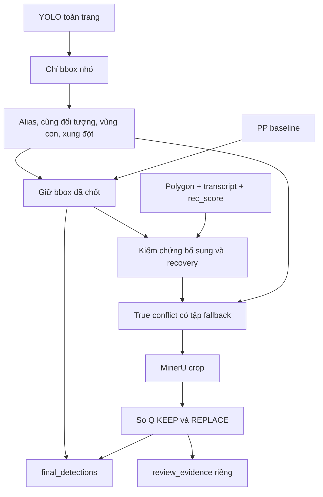

# Cascaded Layout v2.1 — PP baseline, YOLO nhỏ, MinerU theo dòng OCR

Hai notebook `Cascaded_Layout_S_YOLO_MinerU.ipynb` và
`Cascaded_Layout_V3_YOLO_MinerU.ipynb` dùng chung tầng 1–2 trong `src/cascaded/fusion.py`
và hậu xử lý MinerU trong `src/cascaded/attribution.py`.
Chỉ detector PP khác nhau. `core.py` và `fusion.finish_layout` giữ thuật toán v1/v2
để kiểm thử lịch sử; runner mới gọi `attribution.finish_layout`.
Dual-Skip v4 cũ không bị thay đổi. Luật mới, mã checkpoint và vị trí kết quả:
[cascaded_layout_v2_1.md](cascaded_layout_v2_1.md).

## Chạy notebook

1. Chọn môi trường đã có torch/torchvision CUDA và paddlepaddle-gpu phù hợp Windows.
2. Cài `python -m pip install -r method2/requirements-cascaded.txt` nếu thiếu dependency.
3. Restart Kernel rồi Run All **từng notebook một**. Tắt kernel notebook trước trước
   khi chạy bản tiếp theo để giải phóng GPU.
4. Mặc định chạy thật, thử 1 ảnh trước rồi chạy 20 ảnh trên **validation** (`SPLIT='valid'`).
   Chỉ dùng `test` khi đã chốt cấu hình; không chọn ngưỡng theo kết quả test.
5. Đọc bảng `decisions`, panel review màu vàng và metric từng stage. Sau khi chạy cả
   hai bản, điền S_REPORT/V3_REPORT bằng hai file metrics.json cùng taxonomy và dữ liệu.

Cell cài dependency mặc định tắt, không tự thay PyTorch. Lần đầu model cần mạng nếu
chưa có trọng số; các lần sau dùng cache. Lỗi model không tự chuyển sang MOCK/CPU.
`MOCK_MODE=True` chỉ kiểm thử luồng, tách output và không báo chất lượng thật.

Dữ liệu dùng quy ước chung của `src/common/splits.py`:

| Split | Thư mục processed | Annotation |
|---|---|---|
| train | datasets/doclaynet/processed | annotations/train.json |
| valid / val / validation | datasets/doclaynet_val/processed | annotations/validation.json |
| test | datasets/doclaynet_test/processed | annotations/test.json |

Ảnh ở `processed/images/`. Cell dữ liệu tự gọi script gốc `download_doclaynet.py --ensure`
khi thiếu ảnh/GT; đủ thì dùng lại. Script tải shard parquet ảnh gốc (có thể khoảng
400–520 MB cho shard đầu), không trộn preview lightweight. Không cần bật cờ tải mẫu.

## Vai trò model và cấu hình đã chốt

- PP-DocLayout-S hoặc V3 cung cấp baseline score >=0.45; không loại bbox PP chỉ vì nhỏ.
- DocLayout-YOLO (YOLOv10 DocStructBench) chạy toàn trang imgsz=1024, threshold=0.10.
  Chỉ xét bổ sung bbox diện tích <=2% trang **và** chiều cao <=8% trang.
- PP-OCRv5 mobile det/rec: lưu riêng detector score, rec_score, polygon và transcript.
- MinerU2.5-2509-1.2B: tác vụ layout_detect chính thức, không tái nhận dạng nội dung.
- Transformers, CUDA FP16/SDPA, batch=1, tối đa 8 crop/trang, 512 token/crop, cạnh crop768.
- `enable_yolo`, `enable_recovery`, `enable_mineru` bật mặc định. `enable_wbf=False`.

Giữ ba pha tuần tự: Paddle trong tiến trình con -> đóng Paddle -> YOLO -> giải phóng
YOLO -> gating/MinerU. Cell smoke và batch là hai lượt riêng, có thể nạp model lại.
Không cam kết 30–50ms/trang hoặc VRAM 2–3GB trên máy 4GB.

## Luật fusion v2 (nền tảng; hậu xử lý MinerU được thay bằng v2.1)



### Nhãn và hợp nhất

Alias thật được chuẩn hóa (bao gồm table_title->caption, content/abstract->text).
Generic title tương thích doc_title/paragraph_title nhưng không gộp hai subtype này.
Table/image/formula, header/footer/footnote không đồng nghĩa. Không dùng nhóm rộng để
xóa khác biệt lớp trong GT.

Hai đề xuất IoU>=0.50 và nhãn tương thích: giữ bbox/nhãn chi tiết PP, ghi nhận nguồn
YOLO hỗ trợ. Score nguồn không cộng thành confidence. YOLO yếu <0.25 không phủ quyết PP;
PP hơn YOLO ít nhất0.35 cũng giữ PP. Score YOLO cao hơn không đủ để tự thay PP vì score
khác model chưa hiệu chuẩn.

Khung YOLO nằm trong PP (>=80% diện tích YOLO) là quan hệ vùng con, không tự xuất thêm
một detection. Khung nhỏ độc lập score>=0.45 chỉ được thêm sau kiểm chứng OCR/nhãn.
Proposal bất đồng thực sự tạo target, giữ **toàn bộ** tập baseline liên quan cho KEEP;
không xóa PP trước khi MinerU thành công. Target xung đột dùng chung baseline được gộp
để tránh hai lần thay cùng vùng.

WBF tùy chọn chỉ cho cặp một-một cùng nhãn chuẩn hóa và score YOLO>=0.25. Bbox trung
bình theo score chỉ được nhận nếu không mất dòng PP và không lấn vùng đã chốt. Score
PP vẫn giữ nguyên, không tạo confidence tổng hợp. Ablation WBF dùng thư mục config riêng.

### Recovery và transcript

Coverage dòng là diện tích polygon nằm trong bbox / diện tích polygon, ngưỡng0.80.
Dòng có rec_score thiếu hoặc dưới0.75 không được dùng làm bằng chứng semantic chắc chắn.
Baseline PP vẫn giữ ngay cả khi thiếu OCR.

S_lex là heuristic có log lý do: heading ngắn/cỡ chữ/chữ hoa/dấu câu; caption có tiền tố
Hình/Bảng/Figure/Table; bảng có nhiều hàng chứa cột tách rời; công thức có toán tử;
margin có vị trí và cỡ chữ. Thiếu tiền tố caption chỉ là chưa đủ bằng chứng, không phải
phủ nhận caption. Chưa đo độ đậm. Dòng căn giữa đơn độc không chứng minh là công thức.
Không dùng transcript để tự gán nhãn Text cho mọi orphan.

Khung yếu score0.10–0.45 cần S_lex>=0.60, dòng hỗ trợ và không cạnh tranh/đè vùng đã chốt.
Mở rộng text/list_item chỉ nhận dòng rec_score>=0.75, chiều cao lệch <20%, cùng lề/gần nhau,
không có dấu mở đầu heading/caption/list mới và không lấn vùng khác.

### MinerU và KEEP/REPLACE/ABSORB v2.1

Crop lấy pixel gốc, ngữ cảnh20% mỗi cạnh và tối thiểu hai chiều cao dòng. Không vẽ overlay
vào ảnh model; không dùng prompt JSON tự do. MinerU sai định dạng/cắt/hết ngân sách không
làm mất baseline. Không clipping theo target và không áp điều kiện >=80% diện tích bbox
nằm trong target. Thay bằng attribution theo polygon OCR cố định và hàng xóm.

Trên cùng tập dòng mục tiêu:

Q = 0.45*Coverage - 0.30*SplitPenalty + 0.25*S_lex

Coverage dùng hợp các bbox và diện tích dòng, không cộng trùng; SplitPenalty đo diện tích
dòng bị bbox phủ lưng chừng0.20–0.70. S_lex tính theo dòng hỗ trợ từng region, lưu features.
REPLACE cần vượt KEEP hơn0.10; mỗi block S_lex>=0.60. Giữ đủ mọi dòng baseline; orphan
cần tổ hợp ứng viên phủ >=80% số dòng. Chặn dòng/cột rời nhau, chồng lấn phi chữ và
nhiễm dòng ngoài. ABSORB chỉ sửa một Text cùng cột/cỡ chữ, bảo toàn dòng và nhãn cũ,
so Q trên hợp dòng cũ + mục tiêu và cập nhật nguyên khối hoặc hoàn tác.
Xem hướng dẫn v2.1 cho snap theo chiều dọc và tìm partition giới hạn 24 ứng viên/beam32.
Nếu không đạt, giữ PP fallback hoặc đưa orphan vào review. Đây là heuristic, chưa hiệu chuẩn.

## Output, cache và báo cáo

V2.1 lưu riêng ở:

```
method2/outputs/cascaded_layout/<s|v3>/<real|mock>/v2.1/<hash>/
```

Không ghi đè các lần chạy v1/v2. Mỗi ảnh có paddle.json, yolo.json, mineru.json, result.json,
crop và evidence. Manifest chứa config, phiên bản package, source hash, thời gian nạp,
wall time và VRAM. Đổi code/config/ảnh sẽ có cache mới; không tự coi cache cũ là v2.1.

Schema `cascaded-layout-v2.1`:

- final_detections: chỉ vùng được chấp nhận; đồng nhất với stages.final.
- review_evidence: candidate/orphan bị từ chối, quan hệ parent-child, lý do review.
- decisions: KEEP/ADD/REPLACE/ABSORB/WBF/REVIEW, target, baseline, ứng viên, Q và rejection.
- proposals, lines, evidence và timing: nguồn gốc, transcript/score và output thô model.

Review có thể chứa proposal lớn bị loại khỏi vai trò YOLO, không phải detection.
Chỉ số unresolved_line_fraction tính dòng chưa được final giải thích, không đếm mọi dòng
xuất hiện trong review (vì evidence bị từ chối có thể vẫn trùng baseline đúng).

Báo cáo PP riêng -> ensemble có YOLO nhỏ -> recovery -> final. Strict/loose P/R/F1 tại
IoU0.50/0.75, per-class, classification accuracy có điều kiện; thêm TP/FP theo nguồn,
FN theo lớp GT, ID các vùng sai và summary review/decision. **GT chưa phát hiện vẫn tính
FN dù dòng đã đưa review.** Literal generic title là Unmapped; merged-heading là taxonomy
10 lớp riêng. Không thả generic title vào subtype để tăng điểm.

AP cho detector có score đo được; recovery/final AP N/A. Unmapped loại và đếm riêng cho
COCO AP nhưng vẫn chịu phạt strict. Không gán confidence giả cho MinerU hoặc WBF.
Timing/VRAM giữ cách đo trước: PyTorch allocator riêng; nvidia-smi mẫu200ms toàn GPU
bao gồm process khác, có thể bỏ lỡ peak ngắn. Không cộng peak các pha không đồng thời.

## Ablation và kiểm thử

Tắt lần lượt enable_yolo / enable_recovery / enable_mineru để chạy baseline và các mức
bổ sung; bật enable_wbf riêng để đánh giá WBF. Cùng ảnh, GT, taxonomy và config còn lại.
Không chọn ngưỡng bằng tập20 ảnh test cũ. F1 tăng hay giảm đều phải được báo cáo.

```powershell
cd method2
python -m pytest tests/test_cascaded_attribution.py tests/test_cascaded_fusion_v2.py tests/test_cascaded.py tests/test_cascaded_dataset.py -q
# Chạy một ảnh thật trong môi trường bạn đã cài:
python scripts/run_cascaded.py --variant s --split valid --count 1
```

Test v2 bao gồm baseline không bị phủ quyết, ontology, size gate, khung lồng nhau,
fallback nhiều vùng, rec_score thiếu, WBF mất dòng, coverage union, KEEP/REPLACE,
model failure và review tách detection. Test v1 trong core.py giữ làm hồi quy lịch sử.
Test MOCK không chứng minh model thật tăng chất lượng. Kiến trúc trước sửa được giữ
ở `docs/cascaded_layout_architecture_current.md` dưới dạng snapshot v1.

## Kết quả kiểm chứng lịch sử v2 (không phải kết quả v2.1)

Xem [báo cáo 20 ảnh validation](cascaded_layout_v2_validation.md).
Đã qua 123 kiểm thử, chạy hai notebook trong kernel mới với MOCK và chạy model thật
cho cả S/V3. Trên mẫu validation này, F1@0.50 của S: PP52.79% -> final52.53%;
V3: PP56.06% -> final59.36%. Lợi ích V3 đến từ bổ sung YOLO/recovery; chưa có proposal
MinerU nào được chấp nhận. Median toàn pipeline (không tính nạp model) là15.84s/trang
cho S và21.88s/trang cho V3. Chưa đạt thời gian thực; không suy rộng từ20 ảnh ra toàn bộ dataset.
