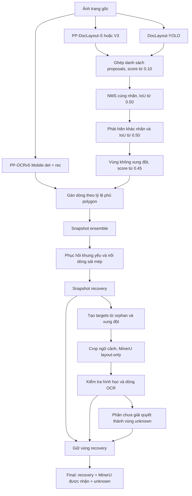

# Snapshot kiến trúc Cascaded Layout v1 — trước sửa fusion

**Tài liệu lịch sử:** runner hiện dùng v2 (`fusion.py`), xem `cascaded_layout.md`.
Các mô tả và số liệu dưới đây giữ nguyên để đối chiếu lỗi của phiên bản trước.

Tài liệu mô tả **mã đang chạy**, chưa áp dụng các phương án sửa sau khi thấy kết quả.
Mục đích: cung cấp đầy đủ cách kết hợp model để phân tích và thiết kế lại.
Không thay đổi model, ngưỡng, prediction hoặc kết quả đánh giá khi viết tài liệu này.

## 1. Thành phần và đầu vào/đầu ra

| Thành phần | Notebook S | Notebook V3 | Đầu ra dùng trong pipeline |
|---|---|---|---|
| Detector chính | PP-DocLayout-S | PP-DocLayoutV3 | Bbox chữ nhật, nhãn, score |
| Detector bổ sung | DocLayout-YOLO-DocStructBench | Giống bản S | Bbox chữ nhật, nhãn, score |
| Detector dòng OCR | PP-OCRv5_mobile_det | Giống bản S | Polygon dòng, score |
| Recognizer OCR | PP-OCRv5_mobile_rec | Giống bản S | Transcript từng dòng |
| VLM vùng khó | MinerU2.5-2509-1.2B | Giống bản S | Các bbox chuẩn hóa + loại vùng |

YOLO được nạp bằng `doclayout_yolo.YOLOv10`, checkpoint
`juliozhao/DocLayout-YOLO-DocStructBench/doclayout_yolo_docstructbench_imgsz1024.pt`.
MinerU: `opendatalab/MinerU2.5-2509-1.2B`, Transformers, API `layout_detect`.

**Mức kết hợp:** hợp nhất các dự đoán đầu ra bằng quy tắc hình học. Các model không
chia sẻ backbone, feature map, attention hoặc trọng số. Không có mô-đun fusion được train.
Không có phép kết hợp xác suất đa phương thức đã hiệu chuẩn.

**Vai trò OCR thực tế:** transcript được lưu nhưng `core.py` không dùng nội dung chữ để
quyết định nhãn hay gom vùng. Polygon dòng mới là dữ liệu được dùng chủ yếu trong gating.
Transcript và nhãn hàng xóm cũng không được gửi thành prompt cho MinerU.

V3 có thể cung cấp thông tin phong phú hơn, nhưng adapter cascaded hiện chỉ giữ bbox,
label, score; không khai thác polygon/mask và reading order riêng của V3.

## 2. Sơ đồ xử lý



Các nhánh trong sơ đồ là luồng dữ liệu. Trên Windows 4GB, thực thi theo pha trên tập ảnh:

```text
Paddle layout + OCR cho tập ảnh → lưu cache → đóng tiến trình Paddle
YOLO cho tập ảnh              → lưu cache → giải phóng YOLO
Gating + MinerU cho tập ảnh   → lưu kết quả cuối → giải phóng MinerU
```

Cell smoke một ảnh là lượt riêng; chuyển sang batch có thể phải nạp lại model.

## 3. Cấu hình đang dùng

| Tham số | Giá trị |
|---|---:|
| Ngưỡng lấy proposals của cả hai detector | 0.10 |
| Ngưỡng vùng mạnh | 0.45 |
| IoU khử trùng cùng nhãn | 0.50 |
| IoU đánh dấu xung đột khác nhãn | 0.50 — dùng chung tham số với NMS |
| Tỷ lệ polygon dòng nằm trong bbox | 0.80 |
| YOLO imgsz | 1024 |
| Cạnh crop MinerU tối đa trước khi vào wrapper | 768 px |
| Crop MinerU tối đa mỗi trang | 8 |
| Token mới tối đa mỗi crop | 512 |
| Batch MinerU | 1 |

Không có cam kết VLM chỉ nhận 5–10% vùng. Ngân sách 8 crop là giới hạn cố định, không
phải chính sách ưu tiên được học hoặc được chọn theo mức lợi ích kỳ vọng.

## 4. Hợp nhất Paddle và YOLO: thuật toán chính xác

### 4.1. Chuẩn hóa một phần nhãn

Adapter lưu `raw_label`, đồng thời đổi một số tên tương đương:

```text
figure / picture → image
plain text → text
figure_title / figure_caption / table_caption / image_caption → caption
display_formula / inline_formula / equation / isolate_formula → formula
```

Giữ `doc_title`, `paragraph_title` và generic `title` là ba nhãn khác nhau.
`label_for(raw, source)` nhận source nhưng hiện không dùng source để có chính sách riêng.
Danh sách alias chưa bao phủ mọi nhãn; ví dụ `table_title`, `content`, `aside_text`
có thể vẫn giữ nguyên và không có mapping trong bộ đánh giá cascaded.

### 4.2. Nối proposals và NMS cùng nhãn

```python
proposals = paddle_proposals + yolo_proposals
proposals = [p for p in proposals if p.score >= 0.10]
proposals = sort_by_score_descending(proposals)

for p in proposals:
    if exists_kept_box(same_label=p.label, IoU_at_least=0.50):
        discard_geometry_of_p_but_record_source_ids()
    else:
        keep(p)
```

Bằng score thì ưu tiên Paddle. Giữ bbox/nhãn/score của proposal thắng, không lấy trung
bình bbox và không cộng xác suất. Score hai model chưa hiệu chuẩn nhưng vẫn được dùng
chung để xếp thứ tự ở bước này. NMS cũng tác động tới các proposal trong cùng một model.

### 4.3. Xung đột khác nhãn

Sau NMS, duyệt mọi cặp proposal:

```python
if p.label != q.label and IoU(p.bbox, q.bbox) >= 0.50:
    conflicts.add(p.id)
    conflicts.add(q.id)

strong = [p for p in proposals if p.score >= 0.45 and p.id not in conflicts]
weak   = [p for p in proposals if p.score <  0.45 and p.id not in conflicts]
```

**Đây là điểm làm mất baseline:** cả hai proposal đều bị loại khỏi strong/weak,
kể cả trường hợp Paddle score 0.95 và YOLO score 0.11. Quy tắc không xét model nào
đáng tin hơn, cũng không phân biệt hai đề xuất cùng model hay khác model.

Ví dụ `doc_title` và `title` có thể bị xem là xung đột dù cùng mô tả một tiêu đề.
Pipeline không tự động khôi phục proposal gốc bị loại nếu MinerU thất bại.

### 4.4. Gán dòng vào vùng mạnh

Với polygon dòng L và bbox B:

```text
coverage(L, B) = area(L ∩ B) / area(L)
```

Ứng viên chủ cần coverage ≥0.80. Nếu nhiều chủ, chọn coverage cao nhất, sau đó bbox
nhỏ nhất; nếu vẫn bằng nhau thì dùng ID để có kết quả xác định. Mỗi dòng tối đa một chủ.

Snapshot `ensemble` chính là danh sách strong sau bước này. Vùng mạnh không có dòng
vẫn được giữ, bao gồm vùng phi chữ.

## 5. Recovery: phục hồi như thế nào?

### 5.1. Khung yếu

Một weak proposal được thêm nếu:

1. Có ít nhất một dòng chưa có chủ được phủ ≥0.80.
2. Không có IoU ≥0.50 với vùng strong.
3. Không có weak proposal khác nhãn cũng phủ ≥0.80 một trong các dòng hỗ trợ đó.

Các weak proposal được kiểm tra với tập strong trước khi thêm đồng loạt; chúng không
được chấm điểm chất lượng toàn khối. Sau khi thêm, gán lại tất cả dòng vào các vùng.
Khung nhận nhãn/score của detector, lý do `weak_box_supported_by_ocr`.

**Điều chưa được xác thực:** có chữ bên trong không chứng minh nhãn đúng; không có
kiểm tra block-level đủ để ngăn nhiều mảnh nhỏ thay thế một paragraph GT.

### 5.2. Mở rộng vùng để nhận dòng sát mép

Với chiều cao dòng trung vị toàn trang h, một dòng chưa có chủ có thể nhập vào vùng
văn bản khi: chồng lấp ngang ≥80% bề rộng dòng, gap dọc ≤h, lệch lề trái ≤h.
Không mở rộng nếu phần mới lấn thêm vào proposal hình/bảng/công thức, hoặc dòng thuộc
proposal đang xung đột. Phải có đúng một chủ hợp lệ.

Mở rộng bbox bằng envelope của bbox cũ và dòng; giữ nhãn cũ. Không dùng transcript
để kiểm tra câu/đoạn. Nhận diện cột ở đây là heuristic overlap/căn lề, không phải một
column graph riêng đã được xác minh.

## 6. Tạo targets và gọi MinerU

### 6.1. Gom dòng chưa được gán

Duyệt dòng theo y/x. Thêm vào một nhóm khi chồng lấp ngang ≥0.50 theo bề rộng nhỏ
hơn và gap dọc ≤1.5 lần chiều cao dòng trung vị của nhóm cộng dòng mới. Nếu phù hợp
nhiều nhóm hoặc không nhóm nào thì tạo nhóm riêng.

Mỗi nhóm tạo một target với bbox envelope và danh sách line IDs. Proposal xung đột
nào chạm vào target thì thêm source IDs và đổi reason thành `detector_conflict`.
Xung đột không có dòng hỗ trợ cũng có thể tạo target riêng, nhưng không gọi MinerU.

### 6.2. Chọn crop

Targets được xử lý theo thứ tự tạo, không ưu tiên theo độ bất định, diện tích hoặc
lợi ích kỳ vọng. Target có dòng được gọi đến khi đủ 8 crop; phần còn lại hết budget.

Crop lấy từ ảnh gốc, mở rộng mỗi cạnh 20% kích thước target, tối thiểu hai chiều
cao dòng, clamp trong trang. Thu nhỏ cạnh dài về tối đa 768. Wrapper MinerU còn resize
ảnh về kích thước layout đã cấu hình 768×768; bbox chuẩn hóa sau đó được ánh xạ về
crop gốc bằng tỷ lệ từng trục.

**Model chỉ nhìn ảnh crop.** Không có overlay khung xanh/đỏ, ID dòng, transcript OCR,
nhãn detector, score detector hoặc bbox hàng xóm trong prompt.

### 6.3. Tác vụ MinerU

Gọi API layout chính thức `MinerUClient.layout_detect`, backend Transformers,
batch=1, SDPA, CUDA FP16 (CPU FP32 nếu chọn rõ CPU). Model đóng băng trọng số.
Không gọi tác vụ nhận dạng nội dung. Tuy nhiên checkpoint có thể trả transcript bảng
thay vì layout; đó là output sai định dạng cần từ chối.

Adapter ghi token thực sinh, raw output; kiểm tra giới hạn token/EOS và số box parser
đọc được so với raw output. Các trạng thái gồm `ok`, `incomplete`, `invalid_output`,
`error`; runner bổ sung `no_target_lines` và `budget_exhausted`.

## 7. Chấp nhận MinerU và ghép final

Cho từng block MinerU trong target:

1. Đổi bbox chuẩn hóa về tọa độ trang và **cắt bbox theo bbox target**.
2. Bỏ box rỗng hoặc nhãn unknown.
3. Phải phủ ≥0.80 ít nhất một dòng thuộc target; các dòng hỗ trợ phải thành một nhóm
   theo heuristic cluster ở trên.
4. Nới lại bbox để bao đầy đủ polygon các dòng hỗ trợ.
5. Từ chối nếu IoU ≥0.50 với vùng đã có, hoặc chạm bất kỳ vùng đã có mang nhãn
   image/chart/table/formula.
6. Nếu các block khác nhãn cạnh tranh cùng dòng thì từ chối; NMS cùng nhãn và không
   nhận hai block dùng cùng một dòng.

Các vùng recovery đã giữ không bị thay thế ở bước này. **Không có so sánh score của
giả thuyết MinerU với KEEP như Dual-Skip cũ**, không có ngưỡng gain 0.10/score 0.60,
không có bộ kiểm chứng semantic qua transcript OCR, cũng không có rollback về
proposal detector đã bị loại ở bước conflict.

Đặc biệt: một block MinerU mang nhãn `image` vẫn có thể được nhận nếu có dòng OCR
hỗ trợ và qua các kiểm tra hình học; việc có dòng không xác minh được nhãn image.

Sau các block được nhận:

```text
final = recovery_regions
      + accepted_mineru_regions
      + unknown_regions_for_remaining_target_lines
      + unknown_regions_for_conflicts_without_lines
```

Dòng chưa được nhận được gom lại thành bbox unknown, needs_review=True. Xung đột
không có dòng cũng sinh một bbox unknown. Tất cả nằm trong danh sách detection final,
không tách thành review-only. Kiểm tra cuối chỉ bảo đảm mỗi dòng OCR xuất hiện đúng
một lần; **bảo toàn dòng không đồng nghĩa phát hiện đúng khối GT**.

Final sắp xếp y rồi x rồi ID; không phải mô hình reading order đa cột.

## 8. Đánh giá và ý nghĩa số liệu

Các mức `paddle / ensemble / recovery / final` dùng cùng ảnh và GT, evaluator chung
`src/common/metrics.py`, ghép một-một theo IoU giảm dần.

- `paddle`: proposals Paddle score ≥0.45 trước khi hợp nhất.
- `ensemble`: các vùng mạnh không xung đột sau NMS/gán dòng.
- `recovery`: ensemble cộng khung yếu được phục hồi và bbox đã mở rộng.
- `final`: recovery cộng kết quả MinerU và các unknown placeholder.

Literal mapping giữ doc_title→Title, paragraph_title→Section-header. Generic title
và các nhãn chưa có mapping thành Unmapped=0. Unknown cũng thành 0. Các detection
này không có lớp GT tương ứng nên chịu FP trong strict và vẫn tham gia loose matching.
Chế độ merged-heading đổi cả GT Title/Section-header và các nhãn title về Heading.

AP chỉ được tính cho các mức detector còn score đo được; ensemble vẫn dùng score
chưa hiệu chuẩn giữa model. Recovery/final AP là N/A. Không có confidence lớp MinerU.

Kết quả người dùng đã cung cấp tại IoU 0.50, literal:

| Stage | S: Precision | S: Recall | S: F1 | V3: Precision | V3: Recall | V3: F1 |
|---|---:|---:|---:|---:|---:|---:|
| paddle | 66.67% | 38.71% | 48.98% | 76.00% | 61.29% | 67.86% |
| ensemble | 68.97% | 16.13% | 26.14% | 75.60% | 51.21% | 61.06% |
| recovery | 23.16% | 17.74% | 20.09% | 70.21% | 53.23% | 60.55% |
| final | 11.36% | 20.56% | 14.63% | 45.76% | 54.44% | 49.72% |

Kiểm tra bổ sung trên 20 ảnh của bản S: YOLO riêng score≥0.45 đạt strict F1 56.95%,
loose F1 79.37%. Vì vậy điểm ensemble giảm không chứng minh YOLO riêng kém hơn Paddle-S.

Các số đếm từ output S đã kiểm tra:

- Paddle baseline 144 vùng; ensemble 58; recovery 190; final 449.
- 246 targets: 244 có reason detector_conflict, 2 orphan thuần.
- Evidence: 67 ok, 38 invalid_output, 5 incomplete, 70 budget_exhausted, 66 no_target_lines.
- Final: 190 vùng từ recovery, 51 vùng MinerU được nhận, 208 placeholder mới.
- Tổng final có 211 vùng nhãn unknown, bao gồm unknown đã tồn tại từ recovery.

`ok` chỉ nói output model hợp lệ ở mức adapter; không đồng nghĩa được nhận vào final
hoặc đúng với GT. Ngược lại, một target có thể cho nhiều block được nhận.

## 9. Các điểm cần nghiên cứu lại — chưa sửa trong snapshot này

1. Chuẩn hóa taxonomy trước khi định nghĩa conflict; không coi mọi khác tên là mâu thuẫn.
2. Bảo toàn baseline khi model bổ sung bất đồng; thiết kế KEEP/replace/abstain có đối chứng.
3. Hiệu chuẩn hoặc tránh so score trực tiếp giữa hai detector.
4. Phân biệt một-một, một-nhiều, phân mảnh và vùng lồng nhau thay vì chỉ dùng IoU.
5. Xác minh khung yếu ở cấp block và nhãn, không chỉ bằng việc có dòng chữ.
6. Chính sách chọn target/crop/budget; kiểm tra MinerU có phù hợp với crop cục bộ.
7. Kiểm chứng nhãn MinerU ngoài sự hiện diện của polygon dòng.
8. Tách review evidence và detection được chấp nhận, đồng thời vẫn đánh giá trung thực
   phần bỏ sót và tỷ lệ abstain, không bỏ unknown chỉ để tăng điểm.
9. Đo ablation từng thành phần và từng nguồn FP/FN, giữ test làm báo cáo cuối.

## 10. Vị trí mã để đối chiếu

| File trong method2 | Trách nhiệm |
|---|---|
| src/cascaded/adapters.py | Gọi Paddle, YOLO, MinerU; metadata và output model |
| src/cascaded/types.py | Config, cấu trúc region/line/result, alias và mapping đánh giá |
| src/cascaded/core.py | NMS, conflict, assignment, recovery, targets, chấp nhận và ghép final |
| src/cascaded/runner.py | Thực thi theo pha, cache, budget, crop và lưu kết quả |
| src/cascaded/report.py | Metric từng stage, conversion nhãn và so sánh |

Đây là tài liệu kiến trúc triển khai hiện tại, không phải bằng chứng các quy tắc đã
được hiệu chuẩn hoặc rằng kết hợp nhiều model sẽ cải thiện chất lượng.
