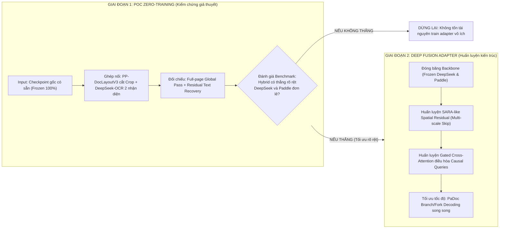
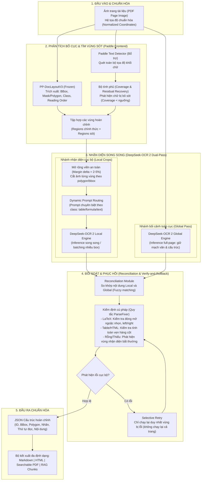
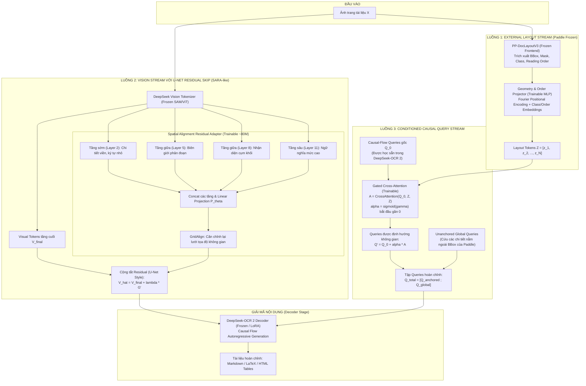
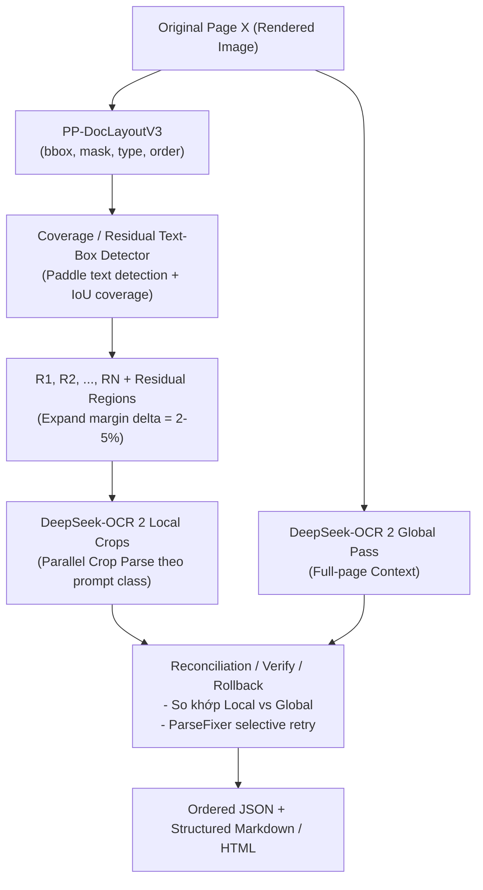
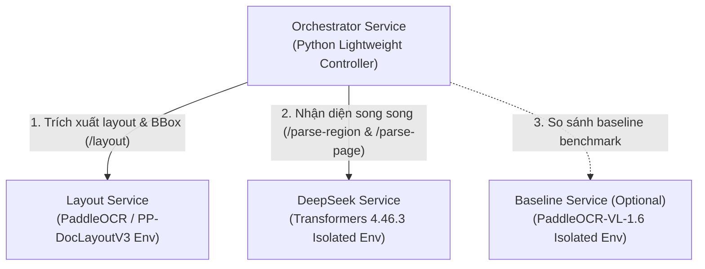
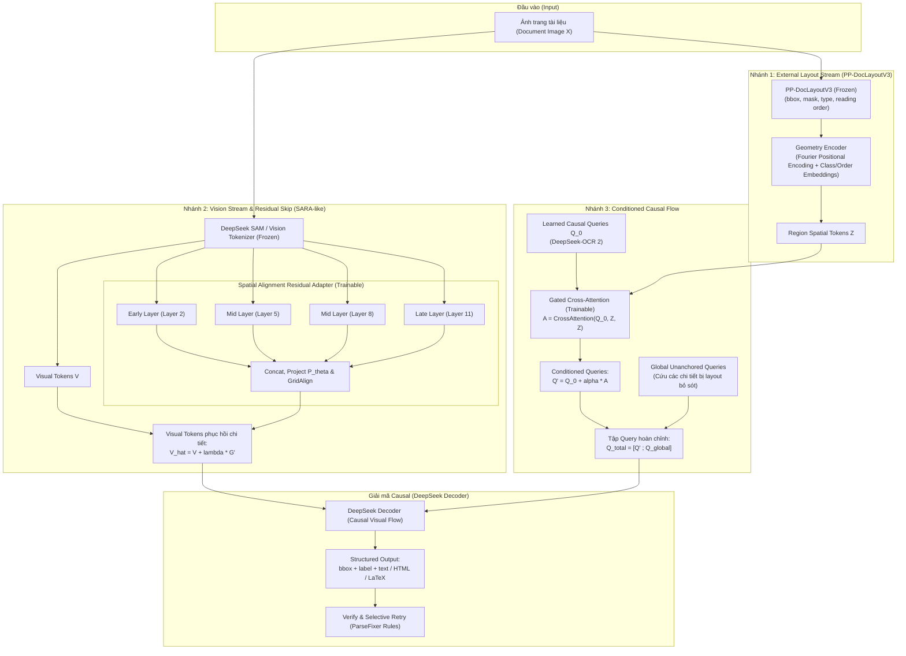

# Nghiên cứu sâu kiến trúc Document Parsing kết hợp Paddle Layout, DeepSeek-OCR và skip-connection kiểu U-Net

## 0. Tóm tắt High-Level & Bản đồ kiến trúc trực quan

Phần này tóm tắt toàn bộ ý tưởng, sơ đồ khối và lộ trình triển khai theo cách trực quan, dễ hiểu nhất trước khi đi vào các phân tích học thuật chi tiết bên dưới.

---

### 0.1. Tóm tắt 1 phút (The Big Picture)

* **Bài toán cần giải:** Xây dựng hệ thống trích xuất tài liệu (Document Parsing) xử lý tốt các tài liệu phức tạp (bài báo 2 cột, bảng biểu không viền, công thức LaTeX, thứ tự đọc phi tuyến tính).
* **3 Trụ cột cốt lõi:**
  1. **PP-DocLayoutV3 (PaddleOCR):** Đóng vai trò "Người dẫn đường không gian" (Spatial Frontend) – phát hiện BBox, Polygon/Mask, phân loại vùng (Class) và xác định thứ tự đọc logic (Reading Order) chỉ trong một lần duyệt (single-pass, 33M params).
  2. **DeepSeek-OCR 2:** Đóng vai trò "Chuyên gia nhận diện & suy luận" (Visual-Language Reasoner) – sử dụng cơ chế Causal Visual Flow để giải mã nội dung tuần tự tự nhiên.
  3. **Skip-Connection kiểu U-Net (SARA-like):** Trích xuất đặc trưng thị giác từ các tầng sớm/trung gian của Vision Encoder để bù đắp chi tiết hình học (nét chữ, viền bảng) đã bị nén mất ở các tầng sâu.
* **Chiến lược tiếp cận 2 giai đoạn (Tránh rủi ro tốn tài nguyên):**
  * **Giai đoạn 1 (POC Zero-Training):** Ghép nối thuần túy ở tầng dữ liệu (Data-level Pipeline) bằng checkpoint có sẵn (PP-DocLayoutV3 crop vùng $\rightarrow$ DeepSeek-OCR 2 nhận diện song song kết hợp đối chiếu Global pass) để kiểm chứng giả thuyết trước.
  * **Giai đoạn 2 (Deep Fusion Adapter):** Khi và chỉ khi Giai đoạn 1 chứng minh được hiệu quả vượt trội, mới tiến hành huấn luyện một adapter nhỏ (~80M tham số, đóng băng backbone DeepSeek) để hòa trộn đặc trưng không gian vào causal queries.

---

### 0.2. Lộ trình chiến lược 2 giai đoạn



---

### 0.3. Sơ đồ khối Giai đoạn 1: POC Pipeline không cần huấn luyện

Đây là pipeline cần làm ngay lập tức, sử dụng 100% mã nguồn và trọng số công khai (Paddle và DeepSeek), chạy phối hợp giữa nhận diện cục bộ (Local Crops) và bao quát toàn trang (Global Pass).



---

### 0.4. Sơ đồ khối Giai đoạn 2: Kiến trúc Deep Fusion với Adapter (Khi huấn luyện)

Khi POC chứng minh tính hiệu quả, hệ thống chuyển sang kiến trúc tích hợp sâu ở không gian tiềm ẩn (Latent Space) với 3 luồng đồng quy:



---

### 0.5. Bảng tra cứu các khối chức năng (Block Dictionary)

Bảng này giúp người đọc tra cứu nhanh chức năng, công nghệ và trạng thái (huấn luyện hay đóng băng) của từng thành phần trong toàn bộ hệ thống:

| Khối chức năng | Thuộc giai đoạn | Công nghệ / Mô hình | Trạng thái Weights | Vai trò & Trách nhiệm chính |
|---|---|---|---|---|
| **PP-DocLayoutV3 Frontend** | Giai đoạn 1 & 2 | RT-DocLayout (PaddlePaddle, 33M) | **Frozen** (Dùng nguyên bản) | Phân tích toàn diện bố cục trang: phát hiện BBox, Polygon/Mask, phân loại semantic (title, text, table, formula, figure) và xác định reading order trong 1 forward pass. |
| **Residual Coverage Detector** | Giai đoạn 1 | Paddle Text Detector + Thuật toán IoU | Không cần train | Quét tìm các vùng chữ nhỏ, footnote, checkbox mà bộ layout bỏ sót để bổ sung thành các residual regions, tránh mất dữ liệu. |
| **Dynamic Prompt Router** | Giai đoạn 1 | Rule-based Prompt Engine | Không cần train | Điều hướng prompt tối ưu cho DeepSeek theo từng loại đối tượng (bảng $\rightarrow$ xuất Markdown/HTML; công thức $\rightarrow$ xuất LaTeX; text $\rightarrow$ giữ ngắt dòng). |
| **Local Recognizer Engine** | Giai đoạn 1 | DeepSeek-OCR 2 (Crop-level) | **Frozen** (Dùng nguyên bản) | Nhận diện chi tiết từng vùng cắt độc lập với độ chính xác cao; chạy song song đa luồng để tối ưu thời gian. |
| **Global Pass Engine** | Giai đoạn 1 | DeepSeek-OCR 2 (Full-page) | **Frozen** (Dùng nguyên bản) | Nhận diện toàn trang một lần để nắm bắt mạch văn, ngữ cảnh xuyên suốt giữa các đoạn và làm mốc đối chiếu kiểm tra. |
| **Reconciliation & Verifier** | Giai đoạn 1 | Heuristic Matching + Nguyên tắc ParseFixer | Không cần train | So sánh kết quả Local vs Global; kiểm tra tính toàn vẹn cú pháp (đóng mở ngoặc LaTeX, cấu trúc thẻ bảng HTML); kích hoạt selective retry nếu phát hiện lỗi. |
| **SARA Spatial Residual (U-Net Skip)** | Giai đoạn 2 | Spatial Alignment Residual Adapter (~80M) | **Trainable** (Huấn luyện mới) | Trích xuất đặc trưng từ các tầng 2, 5, 8, 11 của Vision Encoder, căn chỉnh lưới không gian và cộng tắt (residual add) vào visual tokens cuối để khôi phục độ nét ký tự/đường viền. |
| **Geometry & Order Projector** | Giai đoạn 2 | MLP 2 tầng + Fourier Positional Encoding | **Trainable** (Huấn luyện mới) | Chuyển đổi tọa độ hình học, loại nhãn và thứ tự đọc từ PP-DocLayoutV3 thành các layout tokens $Z$ cùng chiều với không gian embedding. |
| **Conditioned Cross-Attention** | Giai đoạn 2 | Gated Cross-Attention ($\alpha = \sigma(\gamma)$) | **Trainable** (Huấn luyện mới) | Điều hòa các causal queries có sẵn của DeepSeek theo layout tokens từ bên ngoài; ban đầu $\alpha \approx 0$ giúp giữ nguyên năng lực nhận diện gốc, sau đó học dần cách căn chỉnh. |
| **Global Residual Queries** | Giai đoạn 2 | Unanchored Query Tokens | **Trainable** | Các vector query tự do không bị gán vào BBox nào, chuyên trách "cứu" các thông tin bất thường nằm ngoài phạm vi bao phủ của bộ layout. |
| **DeepSeek Language Decoder** | Giai đoạn 2 | DeepSeek-OCR 2 Language Decoder | **Frozen** (hoặc LoRA nhẹ) | Nhận visual tokens đã bổ sung chi tiết không gian và queries đã được điều hòa để giải mã ra chuỗi ký tự theo thứ tự đọc tự nhiên. |

---

## 1. Kết luận kỹ thuật

**Tính đến ngày 24/10/2026, tôi đồng ý với hướng tư duy cốt lõi của bạn, nhưng không đồng ý với cách ghép cụ thể mà Gemini đề xuất ở một vài điểm quan trọng.** Ý tưởng tổng quát:

\[
\text{Image}
\rightarrow
\text{Layout/BBox/Reading Order}
\rightarrow
\text{Visual features}
\rightarrow
\text{spatially anchored queries}
\rightarrow
\text{decoder}
\]

là một hướng rất hợp lý. Tuy nhiên, phần:

\[
q_k=\mathrm{MLP}(v_k\oplus b_k)
\]

rồi lấy \(q_k\) đó **thay trực tiếp causal-flow queries của DeepSeek-OCR 2 mà không huấn luyện** gần như chắc chắn không hoạt động tốt. DeepSeek-OCR 2 dùng các causal-flow query **được học trong quá trình training**, có attention mask riêng, và encoder/decoder được tối ưu cùng nhau. Một vector lấy từ model Paddle, RoIAlign hoặc một MLP ngẫu nhiên không tự nhiên nằm trong đúng latent manifold mà DeepSeek decoder đã học. 

Điều đáng chú ý hơn là từ khi Gemini đưa ra phân tích kia, một paper ngày **14/10/2026** xuất hiện: **Read, Parse, Describe**, với module **SARA – Spatial Alignment Residual Adapter**. SARA lấy hidden states từ nhiều tầng của vision encoder, căn chỉnh chúng lại theo spatial grid rồi **residual-inject** trở lại visual tokens:

\[
\hat T=T+\lambda G'
\]

Đây thực ra còn gần ý tưởng **“U-Net trong Transformer/VLM”** của bạn hơn PaDoc: feature từ các tầng vision sớm được truyền tắt tới representation gần decoder, giữ lại thông tin không gian đã bị compression làm mờ. Backbone được freeze và chỉ adapter được train. 

Nhưng cũng cần điều chỉnh kỳ vọng về tính mới. **Ý tưởng macro “layout trước → các vùng làm anchor → parse từng vùng/parallel → ghép theo reading order” đã có khá nhiều hệ thống**:

- Dolphin: layout elements theo reading order → dùng chúng làm anchors → parse từng phần tử song song. 
- MinerU2.5: low-resolution global layout → native-resolution crop recognition. 
- PaddleOCR-VL: layout analysis → crop các element → VLM recognition → ghép lại theo reading order. 
- Youtu-Parsing: một shared visual representation cho cả trang + region-prompted decoding theo bounding box, thậm chí decode nhiều box song song. 
- PaDoc: shared full-page prefix + layout prefix rồi fork các region-content branches. 

**Phần có khả năng trở thành contribution riêng của bạn không phải “layout + VLM”, mà là:**

> **External explicit layout anchors từ PP-DocLayoutV3 được dùng để điều kiện hóa causal-flow representation của DeepSeek-OCR 2, trong khi vẫn giữ global visual queries và bổ sung multi-layer residual spatial skip giống SARA.**

Trong phạm vi các paper/repository tôi khảo sát tới ngày 24/10/2026, tôi **chưa thấy một hệ thống công bố ghép chính xác bốn thứ này thành một model duy nhất**:

\[
\boxed{
\text{PP-DocLayoutV3 external anchors}
+
\text{DeepSeek causal flow}
+
\text{SARA-like spatial residual}
+
\text{PaDoc-like branch decoding}
}
\]

Nhưng từng thành phần riêng lẻ đã có prior art rất gần. Vì vậy, nếu sau này viết paper, contribution phải được định nghĩa ở **cơ chế alignment/fusion**, không nên claim quá rộng là “lần đầu kết hợp layout và VLM”.

Quan trọng nhất đối với mục tiêu hiện tại của bạn: **không nên train gì ngay.** Có một POC hoàn toàn có thể dựng bằng model public để kiểm chứng khoảng 70–80% giả thuyết kiến trúc trước. Sau đó mới viết adapter nhỏ.

## 2. Đánh giá từng đề xuất của Gemini

| Đề xuất của Gemini | Đánh giá | Tôi sẽ sửa thành |
|---|---|---|
| Thay LayoutLMv3 + Reading Order Encoder bằng PP-DocLayoutV3 | **Đồng ý mạnh** | Dùng PP-DocLayoutV3 trực tiếp để lấy bbox/polygon, class, mask và reading order |
| Dùng `MLP(vision ROI + bbox)` để tạo DeepSeek causal query | **Đồng ý về ý tưởng, không đồng ý zero-shot implementation** | Giữ causal queries gốc; bbox/ROI chỉ **condition/modulate** query qua adapter residual/cross-attention |
| Dùng PaDoc như U-Net skip connection | **Chỉ đồng ý về analogy** | PaDoc là DAG/ancestor-attention/fork decoding, không phải feature skip; SARA mới gần U-Net skip hơn |
| Cộng bbox embedding vào mọi decoder token | **Không thấy bằng chứng PaDoc làm vậy** | Dùng box token/prefix hoặc gated cross-attention; tránh phép cộng latent tùy tiện |
| Giữ Global Context Queries để cứu box bị bỏ sót | **Rất đồng ý** | Ở POC dùng full-page global pass + coverage detector; khi training thì giữ unanchored residual queries |
| PP-DocLayoutV3 33M, bbox + masks + order một forward | **Đúng** | Đây là layout frontend nên chọn |
| 0.189 → 0.041 khi coupled reading-order | **Đúng về số liệu** | Đây tương đương khoảng 78,3% giảm relative error, nhưng 78% là phép tính suy ra, không phải claim gốc |
| “Under-Optimized Region Refinement” của PaddleOCR-VL-1.6 dùng để refine bbox tại inference | **Không đồng ý** | Đây chủ yếu là **data/training optimization framework**, không phải module inference dự đoán \(\Delta x,\Delta y,\Delta w,\Delta h\) |
| ParseFixer verify-and-rollback | **Đồng ý** | Dùng selective re-parsing ở bước cuối |
| ParseFixer + tự động tăng temperature 0.1→0.8 | **Không thấy paper ParseFixer chứng minh chi tiết này** | Có thể thử như heuristic riêng, nhưng không nên gán cho ParseFixer |

### Vì sao nên bỏ LayoutLMv3 khỏi đường chính

Có một nhầm lẫn quan trọng trong mô tả ban đầu: **LayoutLMv3 không phải model lấy ảnh rồi tự biến ảnh thành bounding boxes theo cách bạn đang cần**. LayoutLMv3 nhận document image cùng **text và layout positions**, trong thiết lập text-centric thường có OCR-derived words/bounding boxes; nó học representation chung giữa text, layout và image patches. 

Do đó:

\[
\text{Image}\xrightarrow{\text{LayoutLMv3}}\text{BBox}
\]

không phải pipeline thích hợp.

Thứ bạn thực sự muốn là:

\[
\boxed{
\text{Image}
\xrightarrow{\text{PP-DocLayoutV3}}
\{B_k,C_k,O_k,M_k\}_{k=1}^{N}
}
\]

với:

- \(B_k\): bbox/polygon;
- \(C_k\): semantic layout class;
- \(O_k\): reading order;
- \(M_k\): mask nếu vùng bị cong, méo hoặc không rectangular.

RT-DocLayout/PP-DocLayoutV3 là unified 33M-parameter architecture dựa trên RT-DETR, jointly làm classification, detection, pixel-level segmentation và reading-order prediction; paper báo cáo 132.1 FPS trong điều kiện benchmark của họ. 

Bản weights chính thức hiện có trên Hugging Face dưới `PaddlePaddle/PP-DocLayoutV3` và `PaddlePaddle/PP-DocLayoutV3_safetensors`. 

Điểm Gemini nêu về coupled reading order cũng có cơ sở: paper RT-DocLayout báo cáo decoupled reading-order setup có RO distance 0.189, trong khi coupled learning giảm xuống 0.041; đó là lý do tốt để **không xây một reading-order encoder riêng ngay sau layout detector**. 

### Vì sao không thể “cắm” bbox query thẳng vào DeepSeek

DeepSeek-OCR 2 không đơn giản là một ViT rồi decoder. DeepEncoder V2:

\[
[\text{visual tokens};\text{causal-flow queries}]
\]

trong đó visual tokens có bidirectional attention, còn causal-flow queries dùng causal attention và có thể nhìn toàn bộ visual tokens cùng các query trước nó. Chỉ causal-flow portion ở output encoder mới được đưa tiếp cho language decoder. DeepSeek còn giữ số lượng causal-flow tokens tương ứng với visual-token budget, khoảng 256–1120 tùy chế độ. 

Nói cách khác, query của DeepSeek là một **learned computational interface**, không chỉ là “một vector cùng dimension”.

Nếu bạn làm:

\[
v_k=\operatorname{RoIAlign}(V,B_k)
\]

\[
b_k=f_{\text{geometry}}(B_k)
\]

\[
q_k=\operatorname{MLP}([v_k;b_k])
\]

rồi thay query học sẵn bằng \(q_k\), có ba vấn đề:

**Distribution mismatch.** Decoder chưa từng thấy loại vector đó.

**Cardinality mismatch.** DeepSeek có query gần với visual-token-level representation, còn bạn có \(N\) document regions; một trang có thể chỉ 15–50 regions.

**Semantic capacity mismatch.** Một bbox bảng có thể chứa hàng trăm cell/token; ép nó thành một vector duy nhất là bottleneck quá mạnh.

LayTextLLM chứng minh “một bounding box → một token” có ích cho document understanding, nhưng Spatial Layout Projector của nó **được học**, chứ không phải embedding ngẫu nhiên có thể ghép vào một LLM bất kỳ. 

Do đó, kết luận của tôi là:

\[
\boxed{\text{Do not replace DeepSeek queries. Condition them.}}
\]

Đây là thay đổi quan trọng nhất tôi đề xuất cho kiến trúc của bạn.

### PaDoc đúng ở đâu và Gemini diễn giải quá xa ở đâu

PaDoc thực sự rất thú vị. Nó xem document parse như DAG với image/layout prefix chung và các region-content branches riêng; ancestor attention đảm bảo mỗi branch thấy đúng ancestors mà không phải phụ thuộc nội dung sibling branch. Khi inference, branches có thể chạy song song và tái sử dụng shared-prefix cache. Paper báo cáo trên một A800, so với sequential baseline cùng backbone, throughput tăng 67.4–118% và P95 latency giảm 39.2–54.9%. 

Nhưng phép so sánh:

> “PaDoc chính là U-Net skip connection”

chỉ nên coi là **trực giác**, không phải mô tả kiến trúc.

PaDoc thực chất là:

\[
X,B_{\le k}\rightarrow Y_k
\]

thông qua attention visibility và forked generation.

Không phải:

\[
\text{encoder feature}_l
\rightarrow
\text{decoder feature}_{L-l}
\]

như U-Net.

Và tôi không tìm thấy trong paper bằng chứng cho chi tiết Gemini viết rằng bbox vector được “cộng thẳng vào mọi bước sinh token”. PaDoc dùng shared prefix, ancestor attention và fork-token decoding. 

Ngược lại, **SARA** mới thực sự gần đường skip của bạn: lấy intermediate visual features từ các layer \(\{2,5,8,11\}\), concat, project, spatially align rồi residual-add vào merged visual tokens. 

Đó là paper tôi nghĩ bạn nên đọc kỹ nhất nếu sau này biến prototype thành kiến trúc mới.

### “Under-Optimized Region Refinement” không phải inference bbox-refiner

Gemini cũng hơi kéo quá xa PaddleOCR-VL-1.6. PaddleOCR-VL-1.6 mô tả Under-Optimized Region Refinement như một **region-aware data optimization framework**: tìm vùng mà model cũ làm chưa tốt, cải thiện data/supervision cho những vùng đó, rồi tiếp tục progressive post-training/RL. Nó không được giới thiệu như một inference head nhận box rồi dự đoán \(\Delta x,\Delta y,\Delta w,\Delta h\). 

Do đó ý tưởng bbox-refinement của Gemini có thể là một đề xuất research tốt, nhưng không nên nói PaddleOCR-VL-1.6 đã cung cấp trực tiếp module đó.

## 3. Các công trình gần nhất với ý tưởng của bạn

Nếu xếp các paper theo khoảng cách tới ý tưởng, tôi sẽ nhìn chúng như sau.

| Công trình | Trùng phần nào với bạn | Khác phần nào |
|---|---|---|
| **PaddleOCR-VL / PP-DocLayoutV3** | Explicit bbox, class, reading order → crop → VLM | Không condition DeepSeek causal query |
| **Dolphin / Dolphin-v2** | Layout anchors theo reading order → parallel content parsing | Anchors nội bộ, không external Paddle+DeepSeek fusion |
| **MinerU2.5** | Global layout → native-res crop | Không causal query mechanism |
| **Youtu-Parsing** | Shared whole-page vision features + bbox region-prompted decoding | Không external query embedding kiểu bạn đề xuất |
| **DeepSeek-OCR 2** | Causal-flow visual queries, learnable reading logic | Layout geometry không explicit từ external detector |
| **PaDoc** | Shared page context + branch/fork decoding | Không phải spatial feature skip |
| **SARA** | Multi-level visual features → residual spatial skip | Không dùng external bbox anchors |
| **LayTextLLM** | Bbox → one embedding/token | Chủ yếu document understanding/KIE/VQA, projector phải train |

Dolphin là một prior art rất trực tiếp mà phân tích của Gemini chưa nhấn mạnh đủ. Dolphin dùng đúng paradigm “analyze then parse”: stage đầu sinh sequence layout elements theo reading order; các elements đó trở thành heterogeneous anchors để stage sau parse song song. 

MinerU2.5 cũng rất gần ở cấp pipeline: model 1.2B dùng low-resolution page cho global layout rồi native-resolution crops cho local recognition. 

Youtu-Parsing còn gần ý tưởng “encode whole page một lần, sau đó bbox query vào representation” hơn. Nó dùng dynamic-resolution ViT tạo shared document features, sau đó region-prompted decoding; query parallelism cho phép parse đồng thời tới năm bounding boxes trong setup của paper. 

PaddleOCR-VL hiện tại chính nó cũng đã là pipeline coarse-to-fine. Tài liệu chính thức của Paddle nói rõ full pipeline gồm layout analysis, xác định reading order và crop element ở stage đầu, sau đó VLM nhận từng crop riêng và merge kết quả theo order. PaddleOCR-VL-1.6 tiếp tục sử dụng PP-DocLayoutV3 làm layout frontend. 

Qianfan-OCR năm 2026 đi theo hướng ngược lại: thay vì external detector, nó có **Layout-as-Thought**, trong đó model có thể sinh bbox, element type và reading order trước khi tạo final output. Điều này cho thấy explicit layout reasoning đang trở thành một pattern thực sự trong document VLMs. 

Một điểm thú vị là Qianfan cũng cho thấy explicit layout reasoning **không phải lúc nào cũng làm overall score tăng**; đây là lời nhắc rằng “thêm bbox” chỉ hữu ích nếu cách fusion thực sự phù hợp với model. 

Vì thế, tôi sẽ mô tả novelty tiềm năng của bạn chính xác hơn như sau:

> **Không phải:** “Tôi phát minh pipeline dùng bbox + VLM.”

> **Mà là:** “Tôi nghiên cứu explicit external layout priors như một control signal cho causal visual-flow queries, đồng thời giữ full-page global context và phục hồi multi-scale spatial evidence qua residual feature paths.”

Đây là một thesis research mạnh hơn nhiều.

## 4. Pipeline không huấn luyện để chứng minh ý tưởng (Giai đoạn 1 - POC)

Đây là phiên bản tôi khuyên bạn **làm trước tiên**. Không sửa weight DeepSeek. Không viết projector trainable. Không implement PaDoc attention mask. Mục tiêu là trả lời một câu hỏi đơn giản:

> **External layout geometry + reading order của Paddle có làm DeepSeek-OCR 2 parse document tốt hơn DeepSeek-OCR 2 standalone và PaddleOCR-VL standalone hay không?**

Nếu câu trả lời là không, chưa có lý do để xây kiến trúc phức tạp hơn.

### Luồng tổng thể

Tôi đề xuất POC:



Cấu trúc này lấy ý tưởng global/local từ các coarse-to-fine parser nhưng có thể dựng hoàn toàn bằng checkpoint public. PaddleOCR-VL, Dolphin, MinerU2.5 và Youtu-Parsing đều cung cấp bằng chứng thực nghiệm rằng decomposing page thành layout-guided regions là một paradigm khả thi. 

### Chuẩn hóa input

Render PDF page thành ảnh, nhưng **giữ duy nhất một coordinate system gốc**:

\[
I\in\mathbb{R}^{H\times W\times3}
\]

Mọi bbox được lưu ở cả hai dạng:

\[
B_k^{px}=(x_1,y_1,x_2,y_2)
\]

và:

\[
B_k^{norm}=
\left(
\frac{x_1}{W},
\frac{y_1}{H},
\frac{x_2}{W},
\frac{y_2}{H}
\right)
\]

Đừng để một service resize ảnh rồi lưu bbox theo ảnh resize trong khi service khác dùng ảnh gốc. Đây sẽ là nguồn bug nghiêm trọng hơn cả architecture.

Schema nội bộ nên thống nhất ngay từ đầu:

```json
{
  "page_id": 0,
  "width": 2480,
  "height": 3508,
  "regions": [
    {
      "id": "p0_r0001",
      "bbox_px": [120, 218, 2220, 470],
      "bbox_norm": [0.048, 0.062, 0.895, 0.134],
      "polygon": [],
      "layout_label": "title",
      "layout_score": 0.97,
      "reading_order": 0,
      "source": "pp_doclayout_v3"
    }
  ]
}
```

### Layout pass bằng PP-DocLayoutV3

Đầu vào:

\[
X=I
\]

Đầu ra mong muốn:

\[
\mathcal R=
\{R_1,\ldots,R_N\}
\]

với:

\[
R_k=(B_k,M_k,C_k,O_k,s_k)
\]

trong đó \(M_k\) có thể là polygon/mask thay vì chỉ rectangle.

PP-DocLayoutV3 được thiết kế để trả multi-point boxes và logical reading order, bao gồm các document không phẳng/cong, trong một forward pass. 

**Ở giai đoạn này không cần LayoutLMv3. Không cần một reading-order model thứ hai.**

### Thêm “Residual Region Detector” nhưng vẫn zero-training

Gemini đề xuất Global Residual Queries để xử lý vùng Paddle bỏ sót. Ý tưởng đúng, nhưng chưa train thì ta chưa có query kiểu đó.

Có một cách thực dụng hơn.

Chạy thêm **text detector thuần** trên full page. PaddleOCR có text-detection modules dành riêng cho việc tìm text regions. 

Giả sử text detector sinh:

\[
T=\{t_1,\ldots,t_m\}
\]

Với mỗi text box \(t_j\), tính coverage bởi layout regions:

\[
coverage(t_j)
=
\frac{
\operatorname{area}
\left(
t_j\cap \bigcup_k B_k
\right)
}{
\operatorname{area}(t_j)
}
\]

Nếu:

\[
coverage(t_j)<\tau
\]

ví dụ thử \(\tau=0.5\) hoặc \(0.7\), ta coi đây là một **residual candidate**.

Các residual text boxes gần nhau được cluster thành:

\[
R^{residual}_1,\ldots,R^{residual}_m
\]

rồi đưa vào recognizer giống region bình thường.

Như vậy bạn đã mô phỏng được triết lý:

\[
\text{Box Anchors}
+
\text{Unanchored Residual Recovery}
\]

mà **không train một query nào**.

Đây là một trong những ablation tôi nghĩ rất đáng giá.

### Crop không nên cắt chính xác sát bbox

Với bbox:

\[
B=(x_1,y_1,x_2,y_2)
\]

hãy thử margin:

\[
\delta\in\{0,0.02,0.05,0.10\}
\]

và tạo:

\[
B'=
\operatorname{expand}(B,\delta)
\]

Một bbox layout thường đại diện semantic block, nhưng OCR cần giữ dấu câu, superscript, formula index, border table và một ít neighboring context. Crop sát mép dễ cắt mất chúng.

Đây nên là ablation, không hard-code ngay 5%.

Với document bị warp/perspective, tận dụng polygon/mask của PP-DocLayoutV3 thay vì luôn chuyển về rectangle; chính RT-DocLayout được thiết kế để dùng pixel-level mask cho các vùng hình học phức tạp. 

### Dùng DeepSeek-OCR 2 như local causal recognizer

Mỗi region:

\[
R_k\rightarrow I_k
\]

được đưa riêng vào `deepseek-ai/DeepSeek-OCR-2`, checkpoint public hiện có trên Hugging Face và repository chính thức. 

Đây là “box anchoring” ở mức input-space:

\[
\boxed{
B_k
\Rightarrow
\text{physical crop}
\Rightarrow
\text{DeepSeek causal visual reasoning}
}
\]

chứ chưa phải latent-space anchoring.

Ưu điểm rất lớn: **không có latent alignment problem**.

Tôi sẽ route prompt theo layout class.

Ví dụ, về mặt logic:

```text
text / title / caption / list:
    Recognize text faithfully.
    Preserve line breaks when meaningful.

formula:
    Transcribe the formula into LaTeX.
    Do not explain it.

table:
    Reconstruct the table into structured Markdown/HTML.
    Preserve row/column relationships.

code:
    Transcribe exactly and preserve indentation.

unknown/residual:
    Identify element type, then transcribe its content.
```

Trong metadata gửi kèm, cho recognizer biết:

```json
{
  "layout_prior": "table",
  "reading_order": 12,
  "bbox_normalized": [0.12, 0.43, 0.88, 0.71]
}
```

Tại POC, đừng kỳ vọng decoder “hiểu” tọa độ số theo nghĩa geometric grounding. Metadata chủ yếu giúp debugging và prompt routing; **crop là spatial control thực sự**.

### Full-page DeepSeek pass giữ global context

Song song với local regions, chạy một lần:

\[
Y^{global}=
DSOCR2(I)
\]

để lấy full-page parse.

DeepSeek-OCR 2 được thiết kế để causal-flow encoder tự sắp xếp visual information theo reading logic trước decoder. 

Ta không lấy global result làm ground truth. Nó đóng vai trò:

- global-context reference;
- kiểm tra missing content;
- phát hiện split/merge bất thường;
- kiểm tra order;
- fallback khi local crop sinh output rất kém.

Điểm quan trọng là bạn đang giữ cả hai inductive biases:

\[
\text{Paddle explicit geometry}
\]

và:

\[
\text{DeepSeek implicit causal reading logic}
\]

thay vì bắt một trong hai phải thắng tuyệt đối.

### Parse các box song song

Các region độc lập:

\[
R_1,\ldots,R_N
\]

có thể được batch/parallel.

Đây chính là một trong các lợi thế mà Dolphin, Youtu-Parsing và PaDoc khai thác: document regions phần lớn không cần chờ toàn bộ content của region trước được autoregressively decode xong. 

Ở prototype đơn giản:

```python
asyncio.gather(
    parse_region(r1),
    parse_region(r2),
    ...
)
```

hoặc batching theo loại:

```text
text batch
formula batch
table batch
```

sẽ đủ để chứng minh nguyên lý.

Chưa cần implement fork-token decoder.

### Refine semantic label bằng VLM nhưng không sửa bbox ngay

PP-DocLayoutV3 đã có class prediction \(C_k\).

Đừng bắt decoder sinh lại toàn bộ bbox nếu không cần.

Cho decoder trả:

```json
{
  "content": "...",
  "refined_label": "table",
  "label_conflict": false
}
```

Ta có:

\[
C_k^{layout}
\]

và:

\[
C_k^{VLM}
\]

Nếu hai bên giống nhau:

\[
C_k^{final}=C_k^{layout}
\]

Nếu khác nhau, đặt flag:

```json
"validation_flags": [
    "layout_vlm_label_disagreement"
]
```

rồi mới đưa riêng region đó qua second-pass.

Cách này dễ debug hơn rất nhiều so với để decoder âm thầm thay bbox và class.

### Reconciliation giữa local và global

Mỗi region sau local parse:

\[
L_k=(B_k,C_k,O_k,Y_k)
\]

Full-page parse:

\[
G=(g_1,\ldots,g_m)
\]

Ta có thể normalize strings rồi dùng sequence alignment/fuzzy matching để kiểm tra local content có xuất hiện trong global parse hay không.

Một confidence engineering đơn giản:

\[
S_k
=
w_l s_k^{layout}
+
w_g s_k^{global-consistency}
+
w_v s_k^{validation}
\]

không nhất thiết phải là probabilistic confidence thực sự. Nó chỉ là routing score.

Ví dụ:

```text
High layout score
+ local/global agree
+ valid structure
=> ACCEPT

High layout score
+ local/global disagree
=> second recognizer

Low layout score
+ text detector confirms region
=> REPARSE

No layout region
+ uncovered text detection
=> residual region

Table output invalid
=> selective retry
```

### Verify-and-rollback

Đây là chỗ Gemini dẫn ParseFixer hợp lý. ParseFixer làm backbone parsing trước, sau đó chỉ sửa các vùng/pages không đáng tin và dùng verify-and-rollback để tránh phá những phần đã đúng. 

Bạn có thể áp dụng triết lý này bằng rules rất rẻ.

Với LaTeX:

```text
balanced { }
balanced \left / \right
no obviously truncated ending
```

Với HTML/table:

```text
parser accepts output
row/column structure sane
tags balanced
```

Với Markdown:

```text
code fence balanced
table separator sane
heading hierarchy sane
```

Với OCR:

```text
empty output from a high-confidence text box -> suspicious
large crop + 1 character -> suspicious
```

Chỉ region bị lỗi mới retry.

Không cần chạy lại cả trang.

### Output cuối

Tôi khuyên output canonical không phải Markdown mà là JSON:

```json
{
  "page": 0,
  "elements": [
    {
      "id": "p0_r0001",
      "order": 0,
      "bbox": [120, 218, 2220, 470],
      "polygon": [],
      "layout_label": "title",
      "refined_label": "title",
      "layout_confidence": 0.97,
      "source": "pp_doclayout_v3+deepseek_ocr2",
      "content": "A New Architecture for...",
      "structure": null,
      "validation_flags": []
    }
  ]
}
```

Sau đó mới render:

\[
JSON\rightarrow Markdown
\]

\[
JSON\rightarrow HTML
\]

\[
JSON\rightarrow searchable\ PDF
\]

\[
JSON\rightarrow RAG chunks
\]

Điều này rất giống mục tiêu unified schema của Read-Parse-Describe: mỗi element giữ bbox, semantic class, reading-order và recognized content trong cùng một record. 

## 5. Kiến trúc đúng nghĩa khi chấp nhận train một adapter nhỏ (Giai đoạn 2 - Deep Fusion)

Sau khi POC chứng minh Paddle anchors giúp DeepSeek, lúc đó mới hiện thực hóa ý tưởng latent của bạn.

Tôi **không khuyên thay causal-flow queries**.

Tôi đề xuất ba đường residual song song.

### Vision stream

Ảnh:

\[
X
\]

đi vào DeepSeek vision tokenizer:

\[
V^{(0)},V^{(1)},\ldots,V^{(L)}
\]

DeepSeek-OCR 2 dùng SAM-based visual tokenizer kết hợp DeepEncoder V2/LLM-style visual processing; causal queries được dùng để tổ chức lại visual information theo causal reading flow. 

Ta giữ nguyên backbone này.

### External layout stream

PP-DocLayoutV3:

\[
X\rightarrow
\{B_k,M_k,C_k,O_k\}_{k=1}^{N}
\]

Không backpropagate qua Paddle.

Nó là frozen teacher/front-end.

Tạo geometry vector:

\[
g_k=
[
x_c,
y_c,
w,
h,
w/h,
wh,
x_1,
y_1,
x_2,
y_2
]
\]

tọa độ normalize.

Sau đó Fourier encode:

\[
\phi(g_k)=
[
\sin(2^j\pi g_k),
\cos(2^j\pi g_k)
]_{j=0}^{J}
\]

Thêm:

\[
e_k^{type}=E_c(C_k)
\]

\[
e_k^{order}=E_o(O_k)
\]

### ROI feature không lấy từ một encoder khác

Đây là thay đổi rất quan trọng so với phiên bản đầu của bạn.

**Đừng dùng một vision encoder riêng rồi ghép embedding nó với DeepSeek.**

Lấy ROI trực tiếp từ **feature map của chính DeepSeek vision encoder**:

\[
r_k^{(l)}
=
\operatorname{MaskPool}
\left(
V^{(l)},M_k
\right)
\]

hoặc:

\[
r_k^{(l)}
=
\operatorname{RoIAlign}
\left(
V^{(l)},B_k
\right)
\]

Như vậy feature đã ở đúng visual space của DeepSeek.

Đây là cách giảm mạnh alignment problem.

Dùng nhiều tầng:

\[
r_k=
\operatorname{Concat}
[
r_k^{(l_1)},
r_k^{(l_2)},
r_k^{(l_3)},
r_k^{(l_4)}
]
\]

Ý tưởng này gần SARA, nơi intermediate layers được tái sử dụng vì chúng giữ spatial/boundary information tốt hơn merged features cuối. 

### Box token adapter

Tạo:

\[
z_k=
f_\theta
\left(
[
r_k;
\phi(g_k);
e_k^{type};
e_k^{order}
]
\right)
\]

với \(f_\theta\) chỉ là:

```text
LayerNorm
Linear
GELU
Linear
```

Không cần model 500M khác.

Ta có:

\[
Z=[z_1,\ldots,z_N]
\]

### Không thay causal query, mà residual-condition nó

DeepSeek có causal queries gốc:

\[
Q_0=[q_1,\ldots,q_M]
\]

Giữ nguyên.

Cho chúng attend sang layout tokens:

\[
A=
\operatorname{CrossAttention}(Q_0,Z,Z)
\]

và:

\[
Q'=
Q_0+\alpha A
\]

với:

\[
\alpha=\sigma(\gamma)
\]

và initialize \(\gamma\) để \(\alpha\) rất nhỏ lúc đầu.

Tức là ban đầu:

\[
Q'\approx Q_0
\]

model vẫn cư xử gần DeepSeek-OCR 2 gốc.

Training dần học:

\[
Q'\rightarrow Q_0+\text{layout correction}
\]

Đây an toàn hơn rất nhiều so với:

\[
Q'=Z
\]

### Spatial mask có thể đi thẳng vào cross-attention

Nếu muốn geometry mạnh hơn:

\[
A_{jk}=
\frac{Q_jK_k^\top}{\sqrt d}
+
\beta_{jk}^{spatial}
\]

trong đó bias có thể phụ thuộc:

\[
\beta_{jk}^{spatial}
=
f(
\operatorname{IoU},
distance,
relative\ position,
reading\ order
)
\]

Nếu causal query \(j\) được gán ưu tiên tới region \(k\), mask/bias sẽ ép attention tập trung hơn mà vẫn không xóa global vision information.

### Thêm SARA-like U-Net skip

Đây mới là phần tôi nghĩ biến kiến trúc thành “phiên bản U-Net Transformer” đúng nghĩa.

Lấy các intermediate visual states:

\[
V^{l_1},V^{l_2},V^{l_3},V^{l_4}
\]

project:

\[
G=
P_\theta
\left(
[V^{l_1};V^{l_2};V^{l_3};V^{l_4}]
\right)
\]

align spatial grid:

\[
G'=\operatorname{GridAlign}(G)
\]

sau đó:

\[
\hat V=
V^{final}
+
\lambda G'
\]

Đây gần như chính motif SARA:

\[
\hat T=T+\lambda G'
\]

SARA cho thấy frozen Qwen3.5-2B + adapter khoảng 83.99M trainable parameters đạt F1 0.9189, mIoU 0.8919, OCR accuracy 0.9636 và RO score 0.9774 trong benchmark Read-Parse-Describe của paper; đó không phải bằng chứng trực tiếp cho DeepSeek, nhưng là bằng chứng rất đáng chú ý rằng spatial residual adapter có thể cải thiện layout-sensitive generation mà không full-finetune backbone. 

### Giữ Global Residual Queries

Ở đây tôi đồng ý hoàn toàn với trực giác của Gemini.

Đừng ép tất cả query phải thuộc một bbox.

Tách:

\[
Q=
[
Q^{anchored};
Q^{global}
]
\]

trong đó:

\[
Q^{anchored}\leftrightarrow B_{1:N}
\]

còn:

\[
Q^{global}
\]

không bị mask bởi PP-DocLayoutV3.

Nếu Paddle miss một checkbox, reference, tiny formula, footnote hay vùng bất thường, global queries vẫn có thể nhìn toàn trang.

Có thể thêm coverage loss sau này:

\[
L_{coverage}
\]

để phạt trường hợp visual evidence quan trọng không được bất kỳ region nào cover.

### Một bbox không nên tương ứng đúng một query

Đây là một điểm tôi sẽ thay so với Gemini.

Một paragraph nhỏ và một bảng 40×20 cells không nên có cùng capacity.

Thay:

\[
B_k\rightarrow q_k
\]

bằng:

\[
B_k\rightarrow
\{q_{k,1},\ldots,q_{k,K_k}\}
\]

với:

\[
K_k=
f(
area_k,
class_k,
density_k
)
\]

Ví dụ về nguyên tắc:

```text
title       -> 1–2 slots
paragraph   -> 2–4 slots
formula     -> 2–4 slots
table       -> 8–16 slots
figure/chart-> 4–8 slots
```

Không nên coi các con số này là tối ưu cố định; chúng cần ablation.

Về mặt kiến trúc, đây là điểm hợp lý hơn “one bbox = one query”.

### Decoder ban đầu vẫn giữ nguyên

Tôi sẽ **không implement PaDoc fork ngay ở version đầu**.

Pipeline:

\[
\hat V,Q'\rightarrow
\text{DeepSeek decoder}
\]

vẫn dùng decoder gốc.

Nếu adapter này cải thiện accuracy rõ ràng, **sau đó** mới nghiên cứu branch decoding:

\[
B_1[\mathrm{fork}],
B_2[\mathrm{fork}],
\ldots
\]

PaDoc cho thấy forked regional branches có thể giảm sequential dependency và khai thác shared prefix, nhưng mechanism đó bản thân được thiết kế/training riêng chứ không phải một inference trick có thể chèn miễn phí vào model bất kỳ. 

Thứ tự phát triển hợp lý là:

```text
External layout
      ↓
ROI conditioning
      ↓
Causal-query residual adapter
      ↓
SARA-like spatial residual
      ↓
prove accuracy
      ↓
THEN parallel fork decoder
```

không phải làm tất cả cùng lúc.

## 6. Model, checkpoint và cách dựng hệ thống

### Bộ model tôi chọn cho POC

| Vai trò | Model | Dùng ngay? | Mục đích |
|---|---|---:|---|
| Layout chính | `PaddlePaddle/PP-DocLayoutV3` | **Có** | bbox/polygon/class/order/mask |
| Layout safetensors | `PaddlePaddle/PP-DocLayoutV3_safetensors` | Có | thuận tiện ecosystem khác |
| Local/global OCR | `deepseek-ai/DeepSeek-OCR-2` | **Có** | causal visual parsing |
| Baseline Paddle | `PaddlePaddle/PaddleOCR-VL-1.6` | **Có** | baseline bắt buộc |
| Closest anchor baseline | Dolphin-v2 | **Có** | analyze→anchor→parse |
| Shared-feature region baseline | Youtu-Parsing | **Có** | region-prompted decoding |
| Fork decoder baseline | `Longin-Yu/PaDoc` | Có | test PaDoc concept |
| LayoutLMv3 | — | **Không** | không cần cho POC này |
| SARA | research inspiration | Chưa ưu tiên | cần adapter tuning |

PP-DocLayoutV3 weights chính thức đã public. 

PaddleOCR-VL-1.6 checkpoint hiện public ở `PaddlePaddle/PaddleOCR-VL-1.6`; model card báo cáo 96.33% trên OmniDocBench v1.6 theo benchmark của nhóm tác giả. 

DeepSeek-OCR 2 có checkpoint public `deepseek-ai/DeepSeek-OCR-2` và hỗ trợ load qua Transformers với `trust_remote_code=True`. 

PaDoc checkpoint public là `Longin-Yu/PaDoc`, khoảng 2B parameters theo model card. 

Dolphin/Dolphin-v2 có repository chính thức của ByteDance với pretrained model support. 

Youtu-Parsing có code chính thức và hướng dẫn tải model weights, cùng Python parser. 

### Download checkpoints

Có thể tổ chức:

```bash
mkdir -p models

hf download PaddlePaddle/PP-DocLayoutV3_safetensors \
  --local-dir models/pp-doclayout-v3

hf download deepseek-ai/DeepSeek-OCR-2 \
  --local-dir models/deepseek-ocr2

hf download PaddlePaddle/PaddleOCR-VL-1.6 \
  --local-dir models/paddleocr-vl-1.6

hf download Longin-Yu/PaDoc \
  --local-dir models/padoc
```

Các baseline:

```bash
git clone https://github.com/bytedance/Dolphin.git
git clone https://github.com/TencentCloudADP/youtu-parsing.git
git clone https://github.com/deepseek-ai/DeepSeek-OCR-2.git
git clone https://github.com/Longin-Yu/Padoc.git
```

### Đừng cài tất cả vào một Python environment

Đây là một chi tiết engineering rất quan trọng.

Repository DeepSeek-OCR-2 hiện pin:

```text
transformers==4.46.3
tokenizers==0.20.3
```

trong requirements chính thức. 

Trong khi tài liệu PaddleOCR-VL cũng cảnh báo các backend Transformers/vLLM/SGLang có dependency conflicts trong một số setup và khuyên tách layout/client với VLM service thành environments riêng khi cần. 

Tôi sẽ kiến trúc hệ thống thành services ngay từ đầu:



API layout:

```http
POST /layout
```

trả:

```json
{
  "regions": [...]
}
```

DeepSeek:

```http
POST /parse-region
```

input:

```json
{
  "image": "...",
  "layout_type": "table",
  "order": 4
}
```

output:

```json
{
  "content": "...",
  "refined_label": "table"
}
```

Page parser:

```http
POST /parse-page
```

Paddle docs hiện hỗ trợ PaddleOCR-VL qua nhiều serving backend, và API pipeline có các controls cho layout detection, NMS, unclip ratio, layout shape mode, temperature, max tokens và page restructuring. 

Việc tách service cũng khiến sau này bạn thay:

```text
DeepSeek-OCR2
    ↓
Youtu
    ↓
Dolphin
    ↓
your modified DeepSeek
```

mà không phải sửa layout pipeline.

### Cấu trúc code tôi sẽ dùng

```text
doc_parser_experiment/
│
├── services/
│   ├── layout_service/
│   ├── deepseek_service/
│   ├── paddle_vl_service/
│   └── optional_baselines/
│
├── pipeline/
│   ├── render.py
│   ├── coordinates.py
│   ├── layout.py
│   ├── coverage.py
│   ├── cropper.py
│   ├── routing.py
│   ├── local_parse.py
│   ├── global_parse.py
│   ├── reconcile.py
│   ├── validators.py
│   └── reconstruct.py
│
├── schemas/
│   ├── page.py
│   └── region.py
│
├── evaluation/
│   ├── text_metrics.py
│   ├── layout_metrics.py
│   ├── reading_order.py
│   ├── table_metrics.py
│   └── latency.py
│
└── experiments/
    ├── baseline_paddle/
    ├── baseline_deepseek/
    ├── layout_deepseek/
    ├── layout_deepseek_global/
    └── residual_regions/
```

Cách tổ chức này quan trọng vì mục tiêu ban đầu của bạn không phải build production OCR. Mục tiêu là **ablation nhanh và biết chính xác component nào tạo improvement**.

## 7. Kế hoạch thực nghiệm để biết ý tưởng có thực sự đáng train

Đây là phần tôi coi là quan trọng nhất. Một kiến trúc đẹp trên giấy nhưng nếu không thắng baseline thì không nên đi tiếp.

### Các baseline bắt buộc

Chạy cùng một tập tài liệu qua các cấu hình:

| Experiment | Pipeline |
|---|---|
| A | PaddleOCR-VL-1.6 nguyên bản |
| B | DeepSeek-OCR 2 nguyên bản full-page |
| C | PP-DocLayoutV3 → DeepSeek-OCR 2 crops → merge |
| D | C + full-page DeepSeek global pass |
| E | D + residual text-region recovery |
| F | Dolphin-v2 |
| G | Youtu-Parsing |
| H | PaDoc |

Đây là test quan trọng nhất:

\[
C>A?
\]

Nếu không, việc chỉ thay Paddle recognizer bằng DeepSeek không mang lợi ích.

Sau đó:

\[
D>C?
\]

Nếu có, giả thuyết **global + local** được hỗ trợ.

Sau đó:

\[
E>D?
\]

Nếu có, giả thuyết **anchored queries cần residual coverage** được hỗ trợ.

Và cuối cùng:

\[
E>\max(A,B,F,G,H)?
\]

Nếu có, lúc đó mới có bằng chứng rất mạnh rằng integration của bạn đáng phát triển thành architecture.

### Đừng chỉ đo OCR character accuracy

Một document parser phải đo ít nhất bốn nhóm.

**Text recognition**

\[
CER,\quad NED
\]

**Layout**

\[
Precision,\ Recall,\ F1,\ mIoU
\]

**Reading order**

\[
RO=
1-\mathrm{NormalizedEditDistance}
\]

**Structured elements**

Table:

\[
TEDS / TEDS\text{-}S
\]

Formula:

\[
CDM
\]

PaDoc và các document-parsing benchmarks hiện đánh giá riêng text, formula, layout và reading-order vì một model có OCR tốt chưa chắc parse structure tốt. 

Read-Parse-Describe cũng dùng category-aware IoU matching, OCR edit-distance similarity và normalized edit-distance reading-order score, minh họa rõ việc cần tách các thành phần đánh giá. 

Ngoài quality, đo:

\[
\text{sec/page}
\]

\[
\text{GPU memory}
\]

\[
\text{tokens generated/page}
\]

\[
\text{regions/page}
\]

và:

\[
\text{retry rate}
\]

vì pipeline hybrid rất dễ tăng 1–2 điểm accuracy nhưng chậm gấp vài lần.

### Ablation quan trọng nhất

Tôi sẽ chạy các ablation sau trước khi train bất cứ thứ gì.

**Reading order**

```text
PP-DocLayoutV3 order
vs
simple y/x geometric sort
```

Nếu không có khác biệt, reading-order output hiện chưa tạo giá trị trên dataset của bạn.

**Crop margin**

```text
0%
2%
5%
10%
```

**Layout prior**

```text
generic OCR prompt
vs
label-aware prompt
```

**Global context**

```text
local only
vs
local + global reconciliation
```

**Residual coverage**

```text
layout boxes only
vs
layout boxes + uncovered text boxes
```

**Recognizer**

```text
DeepSeek-OCR2
vs
PaddleOCR-VL-1.6 recognizer
```

**Mask**

```text
rectangular bbox crop
vs
polygon/mask-aware crop
```

**Confidence routing**

```text
recognize every region twice
vs
second model only for uncertain regions
```

Một ablation table sau đó có thể trông như:

| Layout | Local VLM | Global pass | Residual | RO | Text | Table | Latency |
|---|---|---|---|---:|---:|---:|---:|
| — | DS2 | ✓ | — | … | … | … | … |
| PP-V3 | DS2 | — | — | … | … | … | … |
| PP-V3 | DS2 | ✓ | — | … | … | … | … |
| PP-V3 | DS2 | ✓ | ✓ | … | … | … | … |

Chỉ bảng này thôi đã cho bạn biết gần như toàn bộ thesis có đáng tiếp tục hay không.

### Dataset thử ban đầu

Đừng bắt đầu bằng vài nghìn trang.

Tôi sẽ chọn khoảng **100–300 trang khó**, nhưng cố ý đa dạng:

```text
2-column papers
dense newspapers
slides/PPT
borderless tables
formulas
forms
scanned documents
perspective photos
curved pages
small footnotes
references
checkbox/forms
Vietnamese + English mixed pages
```

Sau đó chia lỗi thành taxonomy:

```text
MISS_REGION
WRONG_REGION
WRONG_ORDER
BAD_SPLIT
BAD_MERGE
WRONG_LABEL
OCR_ERROR
TABLE_STRUCTURE
FORMULA_ERROR
GLOBAL_CONTEXT_ERROR
DUPLICATION
HALLUCINATION
```

Điều bạn cần lúc này không chỉ là một overall score mà là biết:

> “Paddle layout sửa được loại lỗi nào của DeepSeek?”

và:

> “External box làm DeepSeek mất gì?”

### Điều kiện để chuyển sang phase adapter

Tôi chỉ bắt đầu train Box-Anchored adapter nếu POC cho thấy ít nhất hai tín hiệu:

\[
\text{PP-layout + DS crops}
>
\text{DS full page}
\]

trên layout/reading-order hoặc dense-region accuracy;

và đồng thời:

\[
\text{local + global}
>
\text{local only}
\]

Nếu hai điều này đúng, bạn đã chứng minh được:

1. explicit geometry cung cấp thông tin có ích mà DeepSeek implicit causal flow chưa khai thác đủ;
2. crop-only làm mất global context;
3. vì vậy một **shared global encoder + box-conditioned causal query** là kiến trúc hợp lý để giải quyết chính trade-off đó.

Đó chính là lý do khoa học để viết adapter.

Nếu ngược lại:

\[
\text{PaddleOCR-VL-1.6}
\ge
\text{hybrid}
\]

thì chưa nên train kiến trúc mới. PaddleOCR-VL vốn đã dùng PP-DocLayoutV3 + region recognition, và đạt 96.33% trên OmniDocBench v1.6 theo báo cáo chính thức; một hybrid phức tạp hơn cần chứng minh nó thắng ở một failure mode cụ thể chứ không chỉ khác cách lắp ghép. 

### Kiến trúc cuối mà tôi cho là đáng theo đuổi

Nếu POC thành công, tôi sẽ đi tới kiến trúc này:



Tôi cho rằng đây là phiên bản cân bằng nhất giữa ý tưởng ban đầu của bạn và những gì literature 2025–2026 đang cho thấy.

Nó giữ được **explicit geometry của Paddle**; PP-DocLayoutV3 thực sự được thiết kế để jointly xử lý location, masks và reading order. 

Nó giữ được **causal visual-flow inductive bias của DeepSeek**, thay vì phá các learned queries bằng foreign latent vectors. 

Nó dùng **shared full-page visual representation**, tránh nhược điểm mất context của crop-only pipelines mà PaDoc/Youtu-Parsing đang cố giải quyết theo những cách khác nhau. 

Nó có **U-Net-like residual path thực sự** dựa trên intermediate visual features, phù hợp với kết quả mới nhất của SARA hơn là cố diễn giải fork-token của PaDoc thành skip connection. 

Và nó giữ **global residual capacity** để không bị “Paddle box quyết định số phận của toàn bộ trang”, một điểm cực kỳ quan trọng đối với bất kỳ pipeline hai giai đoạn nào.

Vì thế, câu trả lời cuối cùng của tôi với đề xuất của Gemini là: **hướng nghiên cứu của Gemini phần lớn đúng, nhưng implementation zero-training mà nó ngầm gợi ý ở phần Box-Anchored Causal Queries chưa đúng về latent alignment; cách gọi PaDoc là U-Net skip cũng chưa chính xác; và “Under-Optimized Region Refinement” của PaddleOCR-VL-1.6 đã bị diễn giải thành inference bbox refinement quá mức.** Phiên bản nên làm đầu tiên là **PP-DocLayoutV3 → DeepSeek-OCR 2 region crops + DeepSeek full-page global pass + residual coverage detector + selective verification**. Chỉ sau khi pipeline này thắng các baseline mới chuyển sang **frozen DeepSeek + trainable Box/ROI residual adapter + SARA-like multi-layer skip**. Đây là con đường ngắn nhất để vừa chứng minh giả thuyết, vừa tránh bỏ nhiều tuần vào một latent-fusion architecture trước khi biết explicit Paddle geometry có thực sự bổ sung điều gì cho DeepSeek causal flow hay không.